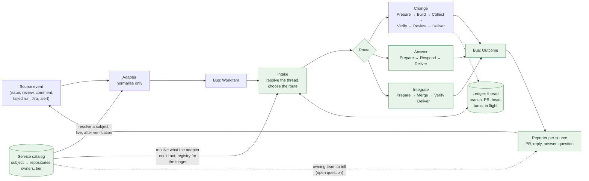

# Design proposal: threads, routes and outcomes

**Status: proposal.** Nothing here is agreed until it is written into `CLAUDE.md`. This document evaluates how extensible the architecture is after Stage 0, names where it has become rigid, and proposes one generalisation that gives the next use cases a home without changing the fixed stage graph.

`docs/design-plan.md` sets out the target beyond Stage 0 (artefact store, roles, fan-out, observability, self-refinement). This document is narrower: it is about the shape of the pipeline between a trigger and a result, and the extension points that shape needs.

## 1. What holds up

The parts of the design that matter most are consistent and enforced, and nothing here proposes changing them.

- **Security.** Credentials stay in orchestrator code, a session is hostile once a model has run in it, commits leave as a bundle and are pushed from a clean room, agents cannot deploy or promote. These are enforced by IAM and by code, not by prompt.
- **A deterministic graph with agents inside states.** The orchestrator decides what happens next; the model never does.
- **The record.** Every stage writes under `<workItemId>/<attempt>/`, the ledger holds pointers and status, and one id correlates everything.
- **Contracts where the orchestrator acts on agent output.** `plan.json` and `review.json` are validated against JSON Schema before anything acts on them, and only named files leave a session.
- **Roles as Runtime versions.** Model, prompt, tools, hooks and limits are fixed on an immutable version, with one image and one invoker serving every role.

## 2. Where it has become rigid

Every new way of interacting with the system has been added as a special case. Each case is correct on its own; together they show the shape that is missing. The next three issues in the backlog (#161 questions, #155 merge conflicts, #15 progress and notification) would each add another.

### 2.1 Adapters interpret as well as normalise

`decidePullRequestEvent` (`packages/triggers-github-issues/src/pull-request-event.ts`) decides that an event is rework, chooses a cause, guesses the previous item from the branch name, and reads the branch out of the pull request body with a regular expression on the Run details table. Prepare then re-derives every one of those facts from GitHub and the ledger, because the adapter is public-facing and holds neither credentials nor ledger access. The contract README says as much: the item's `previousWorkItemId` is "the adapter's guess from the branch name".

`CLAUDE.md` says a triage agent "replaces that function and nothing else"; #161 says triage runs in the state machine, not the adapter, and proposes an interim guard in the adapter that ignores a mention ending in `?`. The design has two answers to where interpretation lives.

### 2.2 The route travels in the contract

`context.cause` records what happened at the source (`review`, `checks-failed`, `comment` in #156) and also tells the pipeline what to do with it. #161 adds `question` and #155 adds `merge-conflict`, each a contract change with a drain before promotion, and #161 has Triage rewrite the cause on the item it records. Principle 5 promises that a new kind of input touches nothing downstream; here every new kind of turn costs a change to the API.

### 2.3 Variation is hidden inside stages

`prepare.ts`, `report.ts`, `open-pr.ts` and `lib/context.ts` each branch on `reworkContext(workItem)`. `WorkContext` carries rework-only optional fields (`reworkPoints`, `previousWorkItemId`). The builder prompt keys its behaviour on whether `/workspace/rework.md` exists. The graph is fixed, but the flows through it are conditionals spread across the Lambdas, and a question, a merge conflict or a plan approval would add a branch to each of them.

### 2.4 The output side has no contract

Inputs have `WorkItem`. Results leave by three GitHub-specific paths: OpenPullRequest opens a pull request, `replyToRework` comments on one, and Report comments on the issue or the pull request. A Jira trigger (#61), an alert (#62) or an answered question (#161) each need new delivery code inside the state machine, and the state machine's terminal states already know which GitHub object to write to.

### 2.5 Continuity is reconstructed three ways

Resume finds an earlier attempt through `sourceKey-createdAt-index`. Rework admission finds the opening item through `pullRequestKey-index`. Both lean on the branch name and a guessed previous id, and the admission policies (one item per pull request at a time, two automatic reworks in a row) live in Prepare. These express one idea: this item continues earlier work on this branch.

### 2.6 Roles are conditionals

`config.role === 'reviewer'` in the host's `options.ts`; `role === 'builder'` in the invoker's `index.ts` and `role.ts`; a separate collector per role for its output files (`collectPlan`, `review-files.ts`, `builder-summary.ts`). Adding the triager and responder from #161 touches the host, the invoker, Collect, the agent template and the state machine.

### 2.7 Context providers have no seam

Seeding a session is spread across Prepare (`notes.md`, `rework.md`), ContinueBuild (the continuing section and the previous notes), PrepareReview (plan, summary, diff) and the invoker (prompt sections from environment variables). The requirement for pluggable context providers, such as a knowledge graph, has nowhere to land.

### 2.8 Verification is one hardwired dispatch

Test dispatches one workflow file in the target repository and waits on a task-token callback. The callback trust is bound to Factorial's own repository (#91): `TestCallbackRole` trusts the OIDC subject built from Factorial's owner and repository ids, so a run anywhere else cannot report and waits out the timeout. Enrolling a target would cost a workflow in that repository, a secret and a change to the human-deployed trust policy, and would let anyone who can edit that repository's workflows report success for a failed run. The smoke test (#50, #51) would be a second hardwired state with its own result shape.

## 3. The generalisation

One model covers all of the cases above: **a work item is a turn in a thread; Intake decides what kind of turn it is; the pipeline replies through an outcome.** The fixed graph stays fixed, each turn is its own execution, and in-flight executions still finish on their version.



### 3.1 Threads: the unit of continuity

A thread is the ledger's record of one branch and everything said about it: the pull request, the base branch, the tested head, the turns that have touched it, which turn is in flight, and the counts the admission rules need. It is keyed by the branch, which every turn on it shares.

- Resume, rework, merge-conflict and question turns all read the thread to find where they continue from, and write it when they finish.
- The admission rules (one turn in flight per thread, at most two automatic reworks in a row, one question in flight) become thread policies in one module, applied by Intake.
- The branch regular expression on the pull request body, the guessed previous id, `sourceKey-createdAt-index` and `pullRequestKey-index` go away. A pull request number or an issue number maps to a thread through one lookup.
- `group` and `parentId` stay as they are: they describe siblings and decomposition, which are relationships between threads, not turns within one.

### 3.2 Intake: normalise at the edge, interpret in the pipeline

Adapters emit facts only: who said what, where, and a reference to what it continues. Intake, a Lambda before Prepare, resolves the thread, fetches what the webhook did not carry (a review's inline comments, a failed run's logs), applies the thread policies, and chooses a **route** from a fixed set. The route and its reasons are recorded on the ledger row and in `intake/intake.json`, and a Choice state selects the path.

This is where the triage agent belongs. Today Intake is a pure function; replacing it with a triager that reads the comment and returns a verdict from the enum changes nothing else, which is what `CLAUDE.md` already promises. The adapter's interim `?` guard in #161 is not needed.

**Contract change.** The `WorkItem` keeps `source` and gains a reference to what the item continues. `context.rework` and `cause` stop being the pipeline's input: the pipeline fetches the facts itself, as Prepare already does. One deliberate change, made once, instead of one per route. A sketch, to be settled in its own contract PR:

```json
{
  "source": { "type": "github-pull-request-comment", "id": "123456", "url": "…" },
  "inReplyTo": { "kind": "pull-request", "number": 87 },
  "title": "…",
  "body": "@factorial please rename this to X"
}
```

`inReplyTo` is optional; an issue has none. The source type says what the event was (a review, a conversation comment, a failed run, an issue, a Jira transition); Intake decides what it means.

**Subjects.** Some sources name a service, a component, an alarm or a channel rather than a repository. The adapter resolves that subject to repositories and owners through the service catalog (§3.8), live, after the event is verified: a deterministic lookup is normalisation, not interpretation, so it stays at the edge. If the catalog is unavailable or returns nothing, the adapter emits the item with the unresolved `subject` and Intake resolves or refuses it. The `WorkItem` therefore carries `repository` or `subject`, never both, and an item with a `subject` runs no stage until Intake has resolved it. A second additive contract change, settled with the first.

Strictness at the edge stays: an adapter rejects unknown fields. Downstream stages could tolerate unknown optional fields, which would remove the drain for most additive changes while keeping the edge strict.

### 3.3 Routes: a short fixed list

A route is which stages run, not a different graph. The builder's prompt gets the route's section instead of inferring the situation from which files exist in `/workspace`.

| Route | When | Stages | Outcome |
|---|---|---|---|
| **Change** | A new request, or rework after a review, failed checks or a request in the conversation | Prepare → Build → Collect → Verify → Review → Deliver, as today | A pull request, or a reply on the existing one |
| **Answer** | A question on a pull request (#161) | Prepare → Respond → Deliver | A comment answering it |
| **Integrate** | The base moved or conflicts (#155) | Prepare → Merge → Verify → Deliver, with Build only when the merge conflicts | The integrated head, tested |
| **Propose** | The requester asks for a plan first | Prepare → Build, stopping after the plan → Deliver | The plan posted for approval; approval is the next turn, which runs Change from the stored plan |
| **Clarify** | The builder cannot proceed without an answer | Any route that ends with open questions instead of a change | The questions posted to the requester; the reply is the next turn, with the questions and answers in its seed |

Propose and Clarify are the first use cases beyond "one request becomes one pull request", and neither needs a new stage: the plan contract already gives Propose its boundary, and the thread gives Clarify its memory. Nothing waits on a task token for a person; a reply is a new turn, so executions stay short.

### 3.4 Outcomes: the output contract

An `Outcome` is the symmetric counterpart of a `WorkItem`: what the pipeline concluded about one turn, put on the bus by the orchestrator at every terminal state. A **reporter** per source type delivers it where the turn came from: opens or updates the pull request thread, answers the question, asks the clarifying questions, or explains a refusal. The GitHub reporter is today's `open-pr.ts`, `replyToRework` and `report.ts` brought together; the notifier seam in #15 is the same thing and should be folded into it.

- The state machine then knows nothing about GitHub comments. A Jira or alert adapter comes with a reporter and nothing else.
- Opening the pull request itself stays a repository-provider operation behind `packages/github-app`. Where the request came from and where the code lives are different dimensions; they coincide today because both are GitHub.
- The outcome is also the dashboard's and the retrospective's input (`docs/design-plan.md` §3.5 and §3.6), so it carries the pointers the ledger already holds, never content.

### 3.5 Role manifests

One module per role, in one package the host and the invoker share: prompt, tools, subagents, hooks, limits, model names by purpose, the files the role is seeded with, and the files it may produce, each with a cap and a validator. The host builds its options from the manifest; the invoker takes the stage name and ledger fields from it; one generic Collect reads the declared outputs. The rule that only named files leave a session becomes data rather than a collector per role.

The template keeps one Runtime block per role, because IAM must stay explicit. The manifest removes the conditionals in the host, the invoker and Collect, so the triager and responder are a manifest, a prompt and a template block.

### 3.6 Session seeds from providers

One function assembles a seed: files to place in `/workspace` and sections to add to the first message. Prepare, ContinueBuild and PrepareReview call it with their providers (the request, the thread's previous turns, the stored plan, the previous round's notes, the diff). A knowledge graph, a memory service or a repository's `.factorial/` instructions (#96) is one more provider. This is the context-provider extension point the requirements ask for, and it costs almost nothing now because it only moves code that exists.

### 3.7 Verifiers

Verify runs an ordered list of verifiers read from the target's `.factorial/verifiers.json` on the base branch, each reporting through one result contract (`verify/<name>/result.json`: name, kind, sha, outcome, exit code, duration and a log pointer), which replaces `lib/test-result.ts`. Verification is Factorial's gate, so Factorial runs it in compute it owns, from a command the target declares, and never by dispatching the target's CI.

- A `command` verifier runs at the tested commit in a fresh session on a verifier Runtime whose role can call no model and read nothing of Factorial's. The orchestrator clones with a short-lived token that never enters the session, checks the head, and hands the workspace to the unprivileged user; the invoker runs the command there through the command API and waits for it. Untrusted test code therefore holds no credentials, spends no model budget and cannot forge its result.
- The sandbox smoke test (#51) is the second kind, run by orchestrator code against a leased account (#50), reporting through the same contract.
- A target with no settings, or an invalid file, is not verified and gets no pull request: an untested change never becomes one.

The target's own CI still runs on the pull request and remains the independent second check. #91's test-gate question is then answered once, for every target: no workflow to install, no secret and no trust policy per repository (#167).

### 3.8 The service catalog

The catalog is the source of repository, service and team ownership, and Factorial reads it live and keeps no copy: a stale mapping is worse than a slow one. One read-only module, shared by the adapters and Intake, with a schema for what comes back, a per-invocation cache only, a short timeout and a result that is data, never an instruction. A lookup that fails or returns nothing is handed on (adapter to Intake) or refused with an ask-back (Intake); nothing guesses.

- **Adapters** resolve a subject to repositories and owners (§3.2) and emit one item per repository with a shared `group`. The adapter's only credential beyond the one that verifies the event is a read-only one for the catalog, used after verification, so a crafted event can at most cause lookups.
- **Intake** resolves what an adapter could not, and gives the triager its registry: the catalog's repositories intersected with the App's installations, with owners and service tier. Tier is the natural input to the triager's priority.
- **Reporters** may use ownership to find the team to tell; whether they should is an open question (§6).

The catalog never overrides a target's own `.factorial/` settings, which stay the authority for how that repository is built, checked and reviewed, and it never grants anything: what Factorial may touch is still the App's installation and IAM. Adding a kind of subject (an alarm, a Jira component, a chat channel) is one lookup in the adapter that receives it; Intake and the contracts do not change.

## 4. What this does not change

- **No dynamic or data-driven state machine, and no agent choosing the next stage.** Routes are a Choice over an enum the orchestrator validated; principle 4 holds.
- **No plugin framework and no workflow DSL.** A route is a few states; a reporter is a Lambda; a provider is a function.
- **No abstraction of the repository provider** before a second one exists. GitHub calls stay behind `packages/github-app`.
- **The plan stays inside the builder.** Propose needs the plan contract, not a separate planner Runtime.
- **Nothing in "Fixed from day one" moves.** Human approval, `live` aliases, the `WorkItem` as the API and the boundaries are untouched; the contract change in §3.2 goes through the process in `contracts/workitem/README.md`.

## 5. Order

The canary (#13) stays first. After that, each item below is done when its first consumer arrives, so that the consumer does not cement the current shape.

| Step | With | Why then |
|---|---|---|
| 1. Thread record and Intake, with the `WorkItem` change | Before #161 | Questions are the first second route; adding them as another `cause` makes the contract the router |
| 2. Role manifests | The PR that adds the triager and responder | The first new roles since the reviewer |
| 3. Outcomes and the GitHub reporter | #15 | The notifier seam is the same thing |
| 4. Session seeds from providers | The next change to seeding | Pure refactor; do it when the code is open anyway |
| 5. Verifiers | Before #50 and #51 | The smoke test is the second verifier and should land on this shape, not beside a dispatched workflow |
| 6. Integrate route | #155 | Reuses the thread and Verify |
| 7. Propose and Clarify routes | When wanted | No new infrastructure; a prompt section, a route and a reporter case each |
| 8. Service catalog | The first source that names a subject rather than a repository (#61, #62, chat) | The `subject` contract change and the shared lookup module land with their first reader |

Each step is one or more work items, and from step 2 onwards most are candidates for Factorial to build itself.

## 6. Open questions

- **Thread key.** The branch is the natural key, but an issue that has not yet produced a branch has no thread until Prepare creates one. Intake can create the thread for a new request, which keeps one rule: every turn belongs to a thread.
- **Where Intake fetches from GitHub.** Intake needs a read token to fetch review comments and run logs, which Prepare mints today. Moving that into Intake moves the fetch earlier but not into the adapter, so the edge stays credential-free.
- **Outcome delivery failures.** A reporter that cannot post (GitHub down, a deleted pull request) must not fail the turn. The outcome is recorded first; delivery is retried from the event.
- **Route enum ownership.** The route is internal, like the plan contract, but the orchestrator acts on it, so it gets a schema under `contracts/` and the same care.
- **Telling the owning team.** The thread records the source that opened it, and the catalog gives the owning team's channel, so a reporter could tell both about turns that came from elsewhere (a review on GitHub, a merge). The design reports each turn where it came from and says nothing more; decide whether the opener and the owner are told, and about which results, before the second reporter exists.
