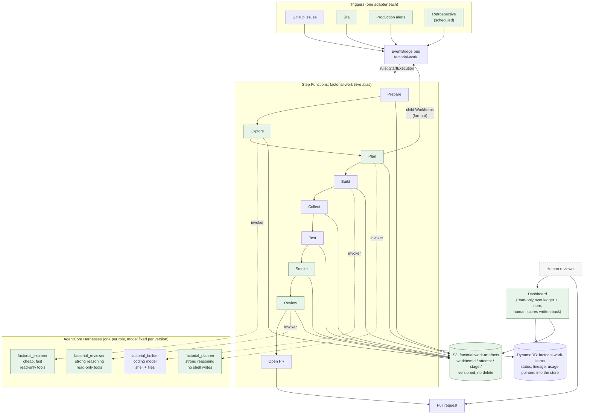
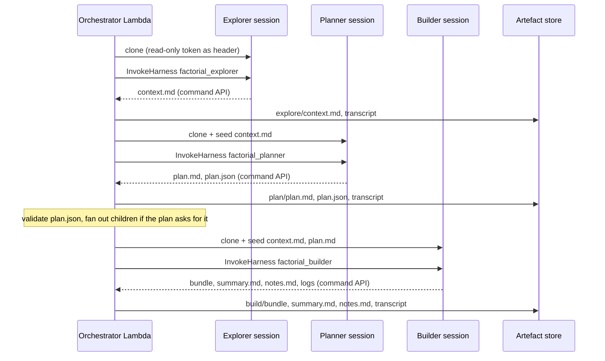
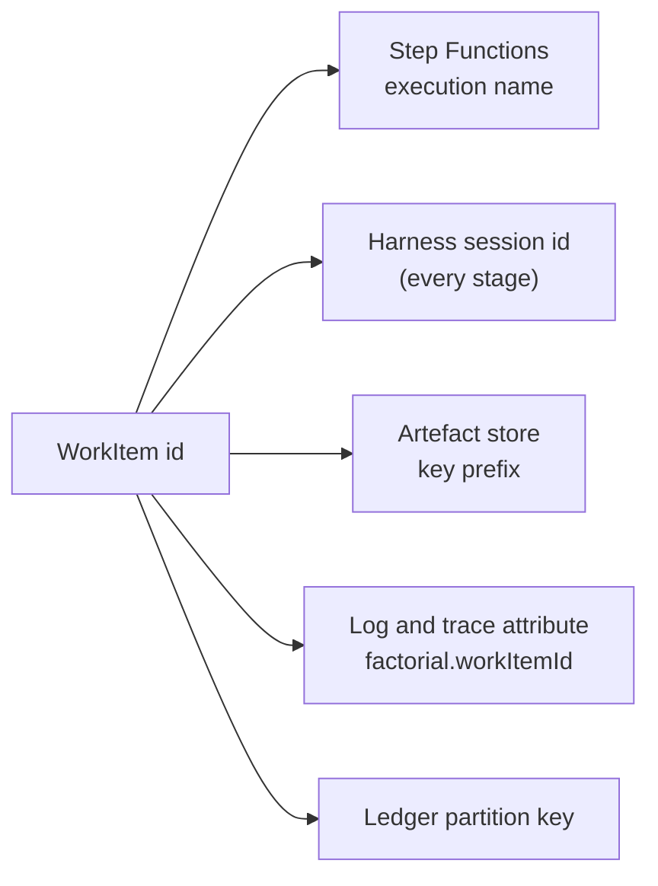
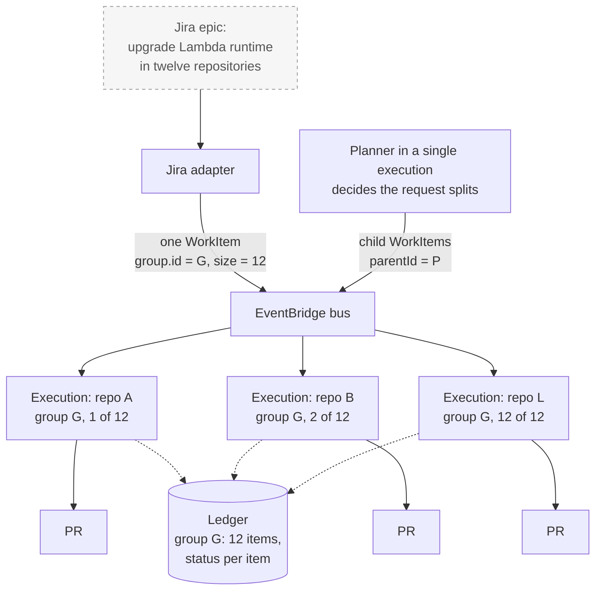
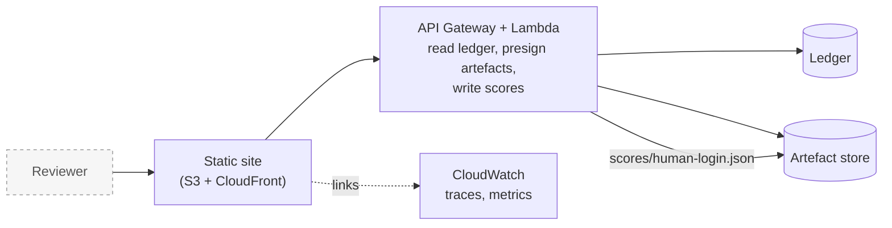
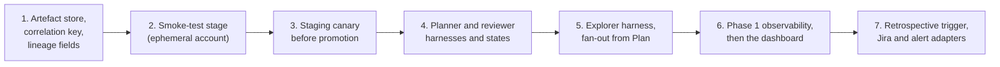

# Design plan: from Stage 0 to a software factory

**Status: proposal.** Nothing here is agreed until it is written into `CLAUDE.md`. This document lays out the target design for Factorial beyond Stage 0, explains why that design follows from what Stage 0 taught us, and separates what must be laid out now from what can be grown later.

`docs/system-diagram.md` shows the system as it is. This document shows where it is going.

## 1. Goals

The design must satisfy the requirements in `CLAUDE.md` plus the following, which Stage 0 did not address:

| Goal | Meaning |
|---|---|
| **Reviewable record** | Every artefact and plan produced during a run is kept, so a human can later assess what the agents did and how well. |
| **Multiple triggers** | Jira, GitHub issues, production alerts and future sources, added without touching the core. |
| **Fan-out** | One trigger can produce many work items, for example a runtime upgrade across many repositories. |
| **Observability** | A single view of every running agent and workflow, and of what each one has done. |
| **Self-refinement** | Factorial improves its own design through its own loop, with a human approving every change to itself. |
| **Model per task** | Cheap, fast models for exploration; stronger reasoning models for planning and review. |

Two constraints are fixed: AgentCore hosts every agent, and the safety limits in `CLAUDE.md` under **Fixed from day one** are not weakened.

## 2. What Stage 0 taught us

Stage 0 closed the loop on 2026-10-17. Getting there, and the work since, exposed the following limits in the current design. Each one is a reason for a specific choice in section 3.

### 2.1 The record of a run is not kept

The invoker streams the harness transcript to CloudWatch Logs as JSON lines, and the ledger (`factorial-work-items`) records status and usage. Everything else the agent produces lives only inside the session: `/workspace/notes.md`, `/workspace/rework.md`, `/workspace/summary.md` and the command logs under `/workspace/logs`. The session is discarded at the end of the run. `summary.md` survives only because it is pasted into the pull request body.

Consequences seen so far:

- Assessing a run means reading log lines in CloudWatch and reconstructing the story by hand. The three live runs needed to close the loop (token format, lazy blob fetch, then success) were each diagnosed that way.
- Usage before PR #20 recorded only the last model call, because the record was a side effect of logging rather than a stored artefact with a defined shape.
- There is no way to compare runs, score them, or feed outcomes back into prompts, because nothing is kept in a form that can be read later.

### 2.2 One agent does everything, with one model

`factorial_builder` plans, explores, builds and summarises in a single loop on GLM 5.3. The pressure this puts on context has driven most of the agent changes since launch: a sliding window (#29) that broke prompt caching, a return to summarisation (#39) that can lose detail, and `notes.md` (#38) to hold the plan and the request outside the context. These are workarounds for asking one loop to hold the whole task.

A single harness also means a single model configuration. The LiteLLM experiment (#17) was forced by Z.ai rejections on the OpenAI-compatible path, and it changed the only agent in the system. There is no way to use a stronger model for the step that most needs one (planning) without paying for it on every tool call of the build.

### 2.3 Relationships between items have been bolted on one at a time

Every relationship between work items so far has been added as a separate mechanism:

- Resuming a failed attempt needed a new ledger index (`sourceKey-createdAt-index`); attempts made before the index existed cannot be found.
- Rework carries `previousWorkItemId` inside `context.kind: "rework"`.
- Retrying means removing and re-adding the label, because the item id is the webhook delivery GUID.
- Fan-out and grouping are deferred in `contracts/workitem/README.md` until the first multi-repository case.

Each of these is correct in isolation. Together they show that lineage (which item follows, retries, groups or decomposes which) is a property the system needs everywhere, and that retrofitting it one case at a time costs a contract change and a ledger change each time.

### 2.4 Observing the system means three consoles

To see what is running, a person reads the Step Functions console for executions, CloudWatch Logs for the transcript, and DynamoDB for the ledger row. Nothing joins them except the work item id, and that only by convention. There is no view of all running agents, no history of outcomes, and no place for a reviewer to record a judgement.

### 2.5 Self-improvement has no signal

Factorial can change itself (issue #2 became PR #3), but the only evaluation is the human review of the pull request, and nothing from that review is recorded. A planner asked to improve the design has no evidence of what went well or badly in earlier runs.

## 3. Target design

The spine stays as it is: EventBridge carries `WorkItem`s, Step Functions runs a fixed stage graph, AgentCore Harnesses run inside the states, and orchestrator Lambdas outside the sandbox hold the credentials. The changes are to what runs inside that spine and what it leaves behind.

### 3.1 Overview



Green items are new. Everything else exists today.

### 3.2 Agents: Harness, one per role, model fixed per harness

**Harness over Runtime.** Harness remains the right AgentCore primitive. The agent loop is configuration (model, prompt, tools, limits, image) captured in immutable versions, which maps directly onto the `live` alias rule. Runtime would only be worth its cost if an agent needed its own internal graph. It does not: Step Functions owns the graph, and every agent is a single loop with a defined input and output.

**One harness per role.** Instead of one agent that does everything, each stage that needs a model invokes a harness built for that role:

| Harness | Role | Model class | Tools | Produces |
|---|---|---|---|---|
| `factorial_explorer` | Understand the repository and the request | Cheap, fast | Read-only shell, file read, web search | `context.md`: relevant files, conventions, risks |
| `factorial_planner` | Decide what to change and how to verify it | Strong reasoning | File read only | `plan.md` and `plan.json` (validated) |
| `factorial_builder` | Make the change | Coding model | Shell, files (as today) | Commits, `summary.md`, `notes.md` |
| `factorial_reviewer` | Judge the result against the plan | Strong reasoning | Read-only shell, file read | `review.json`: score, findings, verdict |

**Model routing is a property of the state machine.** A state chooses which harness to invoke; the harness version fixes the model. Nothing passes a model at invoke time, so the existing rule that the model is fixed on the harness version holds unchanged. Trying a different model for one role is a change to one harness and one deploy, and it cannot affect the others.

**Each harness has its own session.** Sessions belong to a runtime, and each harness is its own runtime, so the explorer, planner, builder and reviewer never share a filesystem. The orchestrator moves what they need between them through the artefact store: it reads the planner's output out of its session with the command API, stores it, and seeds it into the builder's session before the build starts. This is the same mechanism Prepare uses today to seed `notes.md`, and it means every hand-over between agents is an artefact a human can read.



**Security is unchanged.** Each harness has its own `factorial-agent-*` role under the agent permissions boundary. The explorer, planner and reviewer carry fewer tools than the builder, so most model calls in a run happen in sessions that cannot write files at all. No harness gains access to the artefact store, the ledger or GitHub; the orchestrator remains the only writer.

### 3.3 Artefacts: one store, one key

A new bucket, `factorial-work-artefacts`, holds everything a run produces. It is separate from the foundation bucket, which holds deployment inputs and has different retention and access needs.

**Layout.** Objects are keyed by work item, attempt and stage:

```
<workItemId>/<attempt>/
  workitem.json              the WorkItem as received
  prepare/   branch.json     branch, base sha, Factorial version
  explore/   context.md, transcript.jsonl, usage.json
  plan/      plan.md, plan.json, transcript.jsonl, usage.json
  build/     summary.md, notes.md, logs/, bundle.git, transcript.jsonl, usage.json
  test/      result.json, logs/
  smoke/     result.json, logs/
  review/    review.json, transcript.jsonl, usage.json
  pr/        pr.json        number, url, head sha
  scores/    human-<login>.json   written back from the dashboard
```

**Rules.**

- The bucket is versioned, and its policy denies `DeleteObject` to every principal. Retention is a lifecycle rule, not a permission.
- Only orchestrator Lambdas and the invoker write. No agent role can reach the bucket.
- Transcripts are redacted before storage with the same redaction the rework logs use today.
- The ledger holds status, lineage, usage totals and the key prefix. It never holds content.
- The attempt number increments on resume, so a resumed run keeps the earlier attempt's record.

**One correlation key.** The `WorkItem` id is already the Step Functions execution name. It becomes, in addition, the harness session id for every stage, the key prefix in the store, and the `factorial.workItemId` attribute on every log line and trace span. Anything that needs to join logs, traces, ledger rows and artefacts does so on one value.



### 3.4 Fan-out: lineage in the contract, independent executions

The invariant stays: one `WorkItem` produces one branch and one pull request. Fan-out means something emits several `WorkItem`s that share a parent.

**Two producers need it.** Adapters, when the set of targets comes from configuration (an upgrade across a known list of repositories). The Plan stage, when the planner decides the request decomposes into several independent changes. Both put ordinary `WorkItem`s on the bus, so nothing downstream distinguishes a child from a top-level item.

**Children are separate executions, not a Map state.** Each child needs its own ledger row, its own retries and resumption, its own tests and its own pull request. A Map state would give them one execution, one failure mode and one place to time out. Putting them on the bus gives each child the full pipeline for free.

**The parent is a roll-up, not a waiter.** The parent's execution finishes when its plan has been emitted. The ledger links children to the parent, and the dashboard shows a group's progress by querying that link. A step that must run after all children finish (reporting back to a Jira epic, for example) is a separate, later work item that queries the same link. Only if a use case needs it does a parent wait on a task token.



**Contract change.** Two optional, additive fields in `v1`, following the process in `contracts/workitem/README.md` (`contract-change` and `requires-drain` labels, one PR, validator and examples updated together):

| Field | Type | Meaning |
|---|---|---|
| `group` | `{ id: uuid, size: integer, index: integer }` | The set of items one trigger produced. `size` lets a consumer know when the set is complete. |
| `parentId` | `uuid` | The item whose Plan stage emitted this one. |

`context.rework.previousWorkItemId` stays as it is; rework is a relationship of a different kind (same branch, same pull request) and the discriminated union already carries it. Resumption continues to find earlier attempts by `sourceKey`, which also stays. The new fields describe the two relationships the contract does not yet express: siblings and decomposition.

Making this change now, while there is one adapter and one consumer, is the cheapest it will ever be.

### 3.5 Observability: AgentCore and CloudWatch first, a dashboard second

**Phase 1, no new code.** AgentCore's built-in observability exports traces and spans for every harness invocation to CloudWatch. Enabling it and tagging spans with the work item id gives per-session traces for free. The orchestrator Lambdas and the invoker already log structured JSON; adding embedded metrics (stage duration, tool calls, tokens, outcome) gives a CloudWatch dashboard of running executions, outcomes over time and cost per role. Step Functions provides the per-execution view it already provides.

**Phase 2, a bespoke dashboard.** Once the artefact store and the ledger carry the data, the dashboard is a static site that reads them through a small read-only API:



Its views are: running work (every execution and the stage it is in), a group's progress, a run's full record (plan, transcript, diff, test and smoke results, review), and a place to score a run. The score is written back as an artefact and summarised on the ledger row.

The dashboard is a good candidate for Factorial to build for itself. It is a well-bounded piece of work with clear inputs, and it touches none of the safety limits.

### 3.6 Self-refinement: give the loop a signal

The trigger already exists: an issue on this repository with the `factorial` label. What is missing is evidence for the planner to reason from.

- **The reviewer stage** scores every run against its plan and writes `review.json`. This is an automated judgement and is stored alongside the human one; neither replaces the other.
- **Human scores** come from the dashboard and are stored the same way.
- **A retrospective trigger** runs on a schedule (an EventBridge rule, so it is an adapter like any other). It produces a `WorkItem` whose request is to read the last N runs' artefacts and scores and propose improvements. The planner for that item decomposes the proposal into child items, each of which becomes a normal pull request against this repository.

Every pull request against Factorial still needs a human approval, and no agent role can deploy or promote. The loop gets smarter without getting more dangerous.

### 3.7 Triggers

Nothing changes in principle: each source gets an adapter Lambda that emits `WorkItem`s. Two things change in practice. Adapters may emit several items with a shared `group`, and the retrospective trigger shows that an adapter need not be a webhook; a schedule is a source too.

## 4. Why this design

| Problem (section 2) | What the design does about it |
|---|---|
| The record of a run is not kept (2.1) | Every stage writes its inputs and outputs to the artefact store under one key. Transcripts, plans, summaries and logs outlive the session. Usage has a stored shape per stage, not a log line. |
| One agent, one model, context under pressure (2.2) | Each role has a harness with the model that suits it. The builder receives a written plan and a context pack instead of having to produce them in its own context, which lowers the summarisation and note-keeping burden that drove #29, #38 and #39. A model experiment touches one role. |
| Lineage bolted on case by case (2.3) | `group` and `parentId` express siblings and decomposition once, in the contract. The ledger carries them from the start, so no further index has to be retrofitted for them. |
| Three consoles to see one run (2.4) | One correlation key across executions, sessions, logs, traces, ledger and store. Phase 1 joins them in CloudWatch; phase 2 presents them in one page. |
| No signal for self-improvement (2.5) | Automated and human scores are stored per run. A scheduled retrospective reads them and proposes work through the normal loop, with human approval unchanged. |

The design also keeps what Stage 0 got right. Orchestration stays deterministic and outside the agents. Credentials stay outside the sandbox. The hostile-session treatment of the builder extends unchanged to the other roles, which are less dangerous because they hold fewer tools. Promotion stays with the deploy role alone.

## 5. Build now or evolve

The question is which parts are expensive to retrofit. Those are laid out now; everything else is added on the existing spine when its work item arrives.

### 5.1 Lay out now

- **Lineage in the contract.** `group` and `parentId`, while there is one adapter and one consumer. The cost of this change grows with every adapter and every ledger consumer added before it.
- **The artefact store and the correlation key.** A bucket, a key layout and a rule that every stage writes to it. Cheap to add now; every stage written afterwards inherits the convention. Retrofitting the key into stages already built is possible but means touching all of them.
- **The harness-per-role boundary.** Today this is only a naming and template convention plus one rule: the builder's prompt stops absorbing planning and review duties. Splitting a prompt that has grown to do everything is much harder than keeping roles separate from the start.

### 5.2 Evolve

- The Explore, Plan, Smoke and Review states, each added to the stage graph when built.
- The explorer, planner and reviewer harnesses, each an additive template resource with its own `live` endpoint and role.
- Model choice per role, which falls out of having roles.
- Adapter-level and planner-level fan-out, once the contract carries the fields.
- The Jira and alert adapters.
- The dashboard, built last from data that already exists by then.
- The retrospective trigger, once there are scores to read.
- Cost limits per role, once usage is recorded per stage.

### 5.3 Sequence

This slots the new work into the existing order in `CLAUDE.md` (smoke test, then canary) rather than replacing it. The artefact store goes first because the smoke stage is the first producer of results worth keeping, and the lineage change goes with it because it is a contract change and should land before any new adapter.



Each step is one or more work items, and from step 4 onwards most of them are candidates for Factorial to build itself.

## 6. Risks and open questions

- **Hand-over quality.** A plan written by one model and executed by another can be followed too literally or ignored. The reviewer stage scores the result against the plan, which is the signal needed to tune both prompts. Until that stage exists, the builder's `summary.md` should state where it departed from the plan.
- **Cost.** Four invocations per run instead of one. The explorer and reviewer are cheap by construction; the planner is short. Usage per stage in the ledger makes the cost visible before it becomes a problem, and per-role limits follow.
- **Plan validation.** `plan.json` needs a schema if the orchestrator is to act on it (fan out children, choose which tests to run). That schema is internal, not part of the `WorkItem` contract, but it should be treated with the same care.
- **Dashboard authentication.** The read-only API exposes transcripts and diffs. Who may see them and how they sign in is decided when the dashboard is built; IAM Identity Center is the default assumption.
- **Retention.** The store keeps everything by default. A lifecycle rule and a stated retention period are needed before volume grows, and before any repository with sensitive content is targeted.
- **Step Functions alias promotion.** Separating the state machine alias move from the deploy is still tied to the canary (step 3). New states added before that are promoted at deploy time, as today.
