# Decision: AgentCore Harness over Runtime

**Date:** 2026-10-22. **Status:** decided, stay on Harness; superseded (the builder on 2026-10-25, the reviewer on 2026-10-26, the Harness code removed in phase 4), see `docs/agent-sdk-plan.md`. **Revisit:** see the last section.

**2026-10-23:** an implementation plan for option 5 (the Claude Agent SDK on a Runtime) is in `docs/agent-sdk-plan.md`, with Claude reached through Amazon Bedrock rather than Claude Platform on AWS. The Harness remains the default until that plan's phase 2; the repository state before the move is tagged `stage-0-harness`.

**2026-10-25:** the builder spike passed its gate; see **Spike results**. Phase 2 cuts the builder over.

**2026-10-28:** pi evaluated as a sixth option, for model and provider flexibility; see **pi on AgentCore Runtime**. Spike: #181.

A decision record, as principle 6 in `docs/architecture-principles.md` asks for: the question, the evidence, the options, the decision and its consequences. It extends the one-paragraph decision in `docs/design-plan.md` §3.2 with the evidence from the first week of runs.

## The question

Factorial's agents are AgentCore Harnesses: the agent loop is AWS-managed configuration. AgentCore Runtime hosts a loop you write, with full control over the session and the context, the way Claude Code manages its own. Would moving some or all roles to Runtime, with context compaction and subagents under Factorial's control, cut token use and fix the problems seen so far? Or does the current design need optimisation, and are the problems mostly the model (GLM 5.3 Flash)?

## The evidence

### What went wrong, by cause

The ledger held 22 runs on 2026-10-22: 10 pull requests, 2 runs that timed out with no changes, and 10 failures.

| Cause | Runs | Harness-related? |
|---|---|---|
| Orchestrator plumbing (token format, push errors, four Fargate ENI attachment failures, an inactive task definition, an ambiguous git ref) | 8 | No |
| Model wandering on early Flash runs: an hour of exploration without a commit (#4), installing browsers until a Z.ai 1214 rejection (#5) | 2 | No; fixed by the prompt (#14, #41) and reasoning effort |
| Z.ai rejecting the OpenAI chat-completions path mid-run (#17) | 1 | Provider; fixed by the LiteLLM configuration |
| Builder ran out of iterations with half the plan done (#87, PR #92) | 1 | Partly; see below |

No failure was caused by a limit of the Harness loop that Runtime would remove.

### Where the tokens go

The largest run, #87, on GLM 5.3 Flash (artefacts `e61eeb40-ce44-11f1-8234-692b51c98c23/1/`):

| Role | Calls | Input tokens | Served from cache | Context at the end | Stop reason |
|---|---|---|---|---|---|
| Planner | 42 | 1.97M | 92% | 74k | `end_turn` |
| Builder | 150 | 9.37M | 98% | 88k | `max_iterations_exceeded` |
| Reviewer | 40 | 1.65M | 94% | 52k | `max_iterations_exceeded` |

About $0.50 at Flash list price; about $4.40 on the flagship GLM 5.3. Issue #95 breaks the context down: roughly half of the builder's context and 80% of the reviewer's were file reads, led by whole-file `cat` of `plan.md`, `notes.md`, CLAUDE.md and source files. Cost is roughly calls × context, and caching already serves nearly all of the input, so the remaining levers are the number of calls and the size of each read.

The smaller runs the same week (#83: 62 builder calls, 1.83M tokens; #85: 66 calls, 1.25M) finished in one session. Every run since 2026-10-21 has been on Flash; the flagship ran only smaller items between 2026-10-17 and 2026-10-21, so there is no like-for-like comparison yet.

### What Harness and Runtime offer

Checked against the AWS documentation on 2026-10-22.

- **Context truncation.** The Harness applies its strategy (`sliding_window`, `summarization` or `none`) only when the history exceeds the model's context window. There is no threshold setting. With Flash's 1M-token window, summarisation has never fired and a session's context only grows. The sliding window is the only early cut, and it changes the prompt prefix each time it slides, which breaks caching (#29). This is the one Harness gap with no configuration answer.
- **Subagents.** The Harness has none, and offers no framework choice. Its nearest mechanism is the inline function tool: the stream pauses while the caller serves the tool call and sends the result back. The orchestrator could answer such a call by running another harness, but sessions belong to one runtime, so a delegate cannot see the builder's working tree.
- **Hooks.** Lambda, SNS or EventBridge targets before and after an invocation or a tool call; a Lambda hook can deny a tool call. They run under the harness's execution role, which is why Factorial does not use them as control signals (`docs/security.md`).
- **Step Functions.** The optimised InvokeHarness state supports Request-Response only, no `.sync` and no task token, so the Fargate invoker stays whichever primitive is used.
- **Runtime.** A container you write, in any language, behind an HTTP contract; the same microVM isolation, session command API, versioning and endpoints, filesystem options and per-second compute pricing as the Harness. Model selection, the Identity token vault for the model key, execution limits, truncation, streaming, skills and observability all become code you write and maintain. Sessions run for up to 8 hours.

## The options

1. **Stay on Harness and optimise.** Cut reads (#95), move repository conventions into a path skill (#96), keep rounds as the compaction mechanism (#98, PR #99), add the explorer stage (#54), and measure the model per role.
2. **Move the builder to Runtime** with a loop Factorial owns (TypeScript, or Strands on Runtime): threshold compaction, tool-output elision, subagents sharing the session filesystem, prompt-cache control.
3. **Move every role to Runtime.** Option 2 for the planner and reviewer as well.
4. **Move the builder to Bedrock Managed Agents.** OpenAI's Codex harness as a managed service, with the builder's commands running in an AgentCore Runtime. See the section below.
5. **Move the builder to the Claude Agent SDK on an AgentCore Runtime.** Claude Code's harness as a TypeScript library inside a Runtime container Factorial owns. See the section below.
6. **Run the builder on pi on an AgentCore Runtime** (added 2026-10-28). An open TypeScript harness in the host process that reaches any Bedrock model with tool use. See **pi on AgentCore Runtime**.

## The decision

Option 1. The problems seen so far are plumbing, model discipline and read volume. None needs a different loop, and the one Harness limitation that matters, compaction below the model window, already has a substitute. If that gap is still open at re-evaluation, option 5 is the first to spike: it is generally available in `eu-west-1` today, and option 4 is in preview in US regions only.

Why not Runtime now:

- **The gains have Harness-compatible substitutes.** Claude Code's compaction is a summary the loop writes to itself. Rounds are the same idea with the summary (`notes.md` and the branch) as an artefact the orchestrator seeds into a fresh session, which fits principle 3 better: every hand-over is a stored file a human can read, and nothing is read out of the old session. Subagents mainly keep exploration out of the main context; the explorer stage does that in time rather than in space, and its output is a validated artefact rather than a tool result the builder trusts.
- **Runtime moves the loop into the security surface.** Model configuration, limits and the tool allow-list are enforced by the harness version today (`docs/security.md` §3). On Runtime they are enforced by code running inside the sandbox, which the builder can reach. The model key would be fetched by Factorial's own process in the session, giving up the verified property that a shell command in the session cannot read the secret.
- **It is bespoke where the managed service is adequate.** Principle 6 prefers the managed primitive. A loop Factorial owns is code Factorial must review in every pull request it raises against itself, and it reintroduces a second language if it is Strands.
- **Compute costs the same.** Runtime and Harness bill the same per-second CPU and memory; the token bill does not change with the primitive.

## Is it the model?

Partly. The pattern on Flash (an hour of exploration early on, whole-file reads, 150 calls for a six-step plan, the reviewer running out of its 40 iterations) is what a weaker model does, and the prompt changes closed only part of the gap. But token cost at Flash prices is cents per item; the real cost of a weaker model is incomplete runs, extra rounds and human rework, which is what principle 8 says to measure. The decision on the model is per role and should be made from a like-for-like comparison, not from the token bill.

## Consequences and actions

In order:

1. **#95 and #96.** Read rules in every prompt, `plan.json` only, conventions as a path skill. The cheapest change and probably halves the context.
2. **Reviewer limit.** The reviewer hit 40 iterations on #87. Raise the cap or cut what it reads before judging the review's quality.
3. **Model comparison.** Run a #87-sized item on GLM 5.3 and on Flash, and record calls, tokens, rounds and outcome against `planSize` on the ledger. Decide per role; the planner is about 15% of the tokens and benefits most from the stronger model.
4. **Explorer stage (#54).** The builder gets a context pack instead of reading the repository itself.
5. **Record the truncation facts.** The builder's prompt and the design record should say that the harness truncates only beyond the model window and that rounds are Factorial's compaction (#95 item 4).

## Bedrock Managed Agents

Evaluated on 2026-10-22 as a further option. Amazon Bedrock Managed Agents (BMA) runs OpenAI's Codex harness as a service: the model calls, the session and the context compaction happen service-side, and the agent's commands run in an execution environment the customer provides, either a self-hosted host or an AgentCore Runtime running `codex exec-server`. Sessions are durable and multi-turn. Skills are `SKILL.md` directories on the environment's filesystem; tools are STDIO MCP servers in the environment or an AgentCore Gateway. Requests are SigV4-signed, so no OpenAI key exists anywhere.

**What it would give Factorial**

- Compaction below the model window, managed by the harness. This is the one Harness gap with no configuration answer.
- A harness built for coding. The Codex loop's editing and tool discipline are a different class from the Strands shell and file tools, which is where Flash spends its calls.
- No third-party model key. The sandbox holds nothing the shell could exfiltrate, and the model is pinned by an IAM condition (`bedrock-mantle:Model`) on the session role, which is infrastructure enforcement.
- Completion the agent cannot forge: BMA reports the end of a turn service-side, as the Harness stream does today.
- A good fit with the design: BMA would be a new invoker mode for the builder only. The planner and reviewer stay on Harness, and the state machine, clean-room push, test and review stages are unchanged.

**Why it cannot be adopted today**

- Preview regions are `us-east-1`, `us-west-2` and `us-east-2`. Factorial is `eu-west-1` by convention.
- OpenAI models only (`openai.gpt-5.6-luna` in the preview). AWS publishes no price sheet for it, and third-party aggregators disagree with each other.
- The agent definition (model, instructions, tools) is passed by the caller when the session is created. There is no versioned, immutable agent resource and no CloudFormation type, so the orchestrator Lambda would become the versioned home of the prompt. That changes how "model fixed on the version" is enforced and needs a deliberate decision.
- Subagents are explicitly unsupported in the preview.
- Preview API with no console; the documentation warns that APIs and IAM action names can change. Factorial's self-modification loop should not depend on that.
- Unanswered by the documentation: whether the orchestrator can run `InvokeAgentRuntimeCommand` against the microVM that BMA activated (Prepare and Collect depend on it; the alternative is S3 Files mounts, which synchronise asynchronously), how long a turn may run against the lifecycle server's 300-second turn lease, and whether token usage is reported per turn, which principle 8 requires.

**Gates before a spike:** availability in `eu-west-1`, or a decision to accept a US region for the builder; a published price for the model; and an API stable enough to pin. A throwaway spike in `us-east-1`, outside Factorial's stacks, would answer the command-API and turn-length questions in a day.

## Claude Agent SDK on AgentCore Runtime

Evaluated on 2026-10-22 as a fifth option. The Claude Agent SDK is Claude Code as a library (`@anthropic-ai/claude-agent-sdk`): `query(prompt, options)` spawns the bundled `claude` binary as a subprocess that owns the shell, the working directory and the transcript. It ships the built-in tools, automatic compaction as the context nears the window, subagents with isolated context and per-agent tools and model, hooks that run in the host process, permission rules, `maxTurns` and `maxBudgetUsd`, and a result message carrying cost and usage. There is no official AWS guide for it on AgentCore Runtime, but Runtime is a plain ARM64 container behind an HTTP contract, and the SDK's hosting guide covers that shape (one subprocess per session, about 1 GiB RAM, state on local disk).

**What it would give Factorial**

- Compaction below the model window and subagents in the builder's own session, sharing its working tree: both gaps in this record, closed by a harness someone else maintains.
- TypeScript, so the one-language convention holds. The loop Factorial owns is the thin layer around `query()` (seeding, streaming the transcript out, limits), not an agent loop.
- Hooks in Factorial's own process, outside the model's reach. A `PreToolUse` hook is a real guard, unlike Harness hooks, which run under the agent's role.
- Cost and usage per run in the result, and `maxBudgetUsd` as a hard per-item cap, which is most of #63.
- Everything else unchanged. A Runtime has the same microVM, session command API, versions and `live` endpoints as a harness's runtime, so Prepare, Collect, the clean-room push, Test and Review keep working as they are.

**The model becomes a choice.** The SDK reads the same provider variables as Claude Code:

| Route | Model | Key in the sandbox? | Status |
|---|---|---|---|
| Claude Platform on AWS (`CLAUDE_CODE_USE_ANTHROPIC_AWS`) | Claude, first-party API parity | No: SigV4 from the execution role, IAM-controlled | GA in all AWS commercial regions; AWS Marketplace billing in consumption units; no Bedrock model-access approval |
| Amazon Bedrock (`CLAUDE_CODE_USE_BEDROCK`) | Claude | No | Chosen on 2026-10-23: the EU inference profiles for Sonnet 5.5 and Haiku 5.5 are active in `eu-west-1`; the use-case form is the only step outstanding. Claude Code's own web search is unavailable here, so the gateway stays |
| Z.ai's Anthropic-compatible endpoint (`ANTHROPIC_BASE_URL`) | GLM | Yes, unless injected by a proxy outside the sandbox | Documented by Z.ai for GLM 4.7 with Claude Code; GLM 5.3 Flash unverified |

Claude Platform on AWS removes the third-party key the way Bedrock Managed Agents does, and is available in `eu-west-1` now. At first-party list prices Haiku 5.5 costs no more than GLM 5.3 Flash, and Sonnet 5.5 is the tier at which the step-count pattern seen on Flash goes away. The harness is tuned for Claude; a GLM model behind the Anthropic-compatible endpoint would get the loop but not the model it was built around.

**Costs and risks**

- Factorial owns the Runtime container and the layer around the SDK. Smaller than a Strands loop, but code in the security surface and in every pull request Factorial raises against itself.
- The agent definition (prompt, tools, model) lives in that code and is versioned by the Runtime version rather than a harness version. The `live` alias rule holds unchanged; "model fixed on the version" is enforced by the Runtime version (its environment and the host code), which needs a deliberate decision and a note in `docs/security.md`. Checked 2026-10-23: Claude Platform on AWS has no per-model IAM condition key, so there IAM scopes the role to the workspace and no further; on Bedrock the execution role is scoped to the model's inference profile ARN, which is why Bedrock was chosen.
- With a Z.ai key, `ANTHROPIC_AUTH_TOKEN` sits in the subprocess environment, readable from the shell. The SDK's own guidance is a credential-injecting proxy outside the sandbox. Claude Platform on AWS avoids the problem.
- The SDK is licensed under Anthropic's Commercial Terms of Service, not an open-source licence. The dependency convention requires stating that before it is added.
- `bypassPermissions` cannot run as root, and Runtime command sessions run as root. The SDK would run as a non-root user in the container, which `docs/security.md` already lists as a change to make.
- Subagent fan-out needs the depth, concurrency and budget caps set, or one run can grow into a tree of agents.

**Is it a better design than Factorial's?** It is a better agent layer than the Harness for the builder, provided the model is Claude. It is not a replacement for the design: triggers, the state machine, the orchestrator Lambdas, the GitHub App tokens, the clean-room push, the trusted test workflow, the artefact store and the ledger are what make Factorial safe and reconstructable, and none of them depends on which harness runs inside the Build state. What it would simplify is the agent stack: the per-role harness template and its gotchas, the invoker's stream handling, and later the rounds mechanism (compaction replaces it) and the plan hand-over (a plan subagent can write `plan.json` in the same session, still validated and stored by the orchestrator). The reviewer stays a separate session on whichever harness, because judged output must never run in the session that produced it.

**What changes in the design.** Asked on 2026-10-23: would the SDK change the overall design, and would the three harnesses consolidate? The spine does not change; the agent layer does, and three harnesses become two Runtimes.

- Unchanged: triggers, the state machine, the orchestrator Lambdas and App tokens, the clean-room push, the trusted test workflow, the artefact store, the ledger and the boundaries. The Fargate invoker stays too, since a Runtime is still invoke-and-stream with no Step Functions integration that waits; its stream handling gets simpler, reading SDK messages rather than harness events.
- Planner into builder. The planner is a separate harness only because a harness has no subagents and a session's context only grows. With the SDK, planning is a subagent in the builder's session with isolated context and read-only tools. The plan artefact survives: the builder writes `plan.json`, a hook in the host process validates it against the contract before the build phase starts, and the orchestrator still stores it and records plan size. The one-retry-then-`invalid-plan` rule moves into the session, with the orchestrator's validation of the stored plan still the final word.
- Explorer into builder: #54 becomes a subagent definition, not a stage.
- Rounds become a safety net for time and turn limits; compaction is how a long item fits in one session.
- The reviewer does not consolidate. It must run in a fresh session on the tested branch, with rules from the base branch and no view of the builder's context: a trust rule and an anchoring rule. It is a second Runtime with read-only tools and its own execution role.
- The template already supports this. The three roles' IAM policies are near-identical (workload identity, model key, web search gateway); the differences are prompt and tool allow-list, which become subagent definitions in one versioned image. IAM principals and `live` endpoints drop from three to two; agent definitions in code rise, all inside one Runtime version.

The state graph would change in two steps: first keep every state and point Plan and Build at the builder Runtime with a mode switch and Review at the reviewer Runtime, which proves compaction and subagents without touching orchestration; then merge Plan and CollectPlan into Build once the in-session plan artefact is validated the same way. A separate Plan state stays only for the later feature where one trigger fans out into child work items through the lineage fields, which needs a plan before any build exists. Three things for the spike to settle: whether the gateway's web search can be offered to the SDK as an in-process tool, since Claude Code's own web search is unavailable on Bedrock; where the one-language and "the loop is configuration" conventions land, since the agent definition becomes TypeScript on a Runtime version; and the subagent caps.

**Security model.** The outer model (`docs/security.md`) does not change; every boundary that matters is outside the session, and the SDK touches none of them. No credential enters the sandbox: on Bedrock the role signs with SigV4 and holds no key, which is exactly rule 2's production shape, and the role's rights stay model calls and logs. The session is hostile from the first token and output leaves as named files through the command API, capped, redacted and validated. The clean-room push, bundle hand-over, trusted test workflow and tested-head check never see which harness ran inside Build. The reviewer stays a separate Runtime, session and IAM role; section 3.4 forbids anything that judges or ships the builder's output from sharing its session, and that rule gains weight under the SDK because a review subagent would be easy to write and wrong.

Folding the planner into the builder crosses no boundary if two conditions hold. Section 3.4 allows sharing a session when the earlier role cannot write: the plan subagent runs before any write, with Read, Grep and Glob only and Bash denied, so the builder starts in a session no model has written to. And the plan remains a trust transition under rule 4: the orchestrator reads `plan.json` out, validates it and stores it whatever a hook decided in the session, and a build whose stored plan fails validation is still `invalid-plan`. The outer check stays the gate; the in-session hook is a short-cut. The explorer subagent is the same case, read-only in a session that is already the builder's.

What does change is where in-session enforcement lives. Today the tool allow-list and model are enforced by the harness, a managed process in the microVM that Factorial does not own. With the SDK they are enforced by Factorial-owned TypeScript in the same microVM: permission rules, hooks and subagent definitions. Section 3.4 names this as the thing to avoid, "code running inside the sandbox". The model's shell runs as the same user as that process unless the image prevents it, so without care it could edit settings on disk, the agent definitions or the hook scripts. The mitigations are image-level:

- The agent subprocess runs as a non-root user, which the SDK requires for `bypassPermissions` anyway; the host process, the SDK files and the agent definitions are root-owned and read-only to that user.
- Agents, hooks and permission rules are passed in code with `settingsSources` empty, so nothing on disk under `.claude/` is read.
- The model is fixed by the Runtime version, set in its environment and passed by the host code, never taken from the request, and by the execution role, which is allowed one Bedrock inference profile. (Claude Platform on AWS has no per-model condition key; checked 2026-10-23.)
- Subagent depth, concurrency and `maxBudgetUsd` caps are set in the host process.
- No subagent's output is evidence. The builder's summary is already the model's claim, and subagent reports are the same.

Even so, the in-session allow-list is what section 8 already says it is: a constraint on what a prompt injection can drive, never the access gate. The gate remains the outer rules. Rule 6 would be reworded from "each agent role is its own harness" to "each trust boundary is its own Runtime, session and IAM role; subagents share their parent's trust level and never cross one". Net: no outer boundary weakens, and one in-session control moves from AWS-owned to Factorial-owned code, which is an accepted-risk entry for `docs/security.md` with the mitigations above, in the style of the root decision.

**What it would look like.** `docs/system-diagram.md` redrawn for this option, after both steps of the state-graph change above. Blue-bordered nodes are new or changed; the dotted red node lists what goes; everything else is the system as it is. Human-provided inputs and the triggers stack are collapsed, since neither changes.

```mermaid
flowchart TB
    classDef human fill:#f6f6f6,stroke:#999999,stroke-dasharray: 4 4,color:#555555
    classDef changed stroke:#2f6f9f,stroke-width:2px
    classDef removed fill:#f6f6f6,stroke:#c0392b,stroke-dasharray: 4 4,color:#555555

    %% ------------------------------------------------------------------ GitHub
    subgraph github["GitHub"]
        direction TB
        issue["Issue #N<br/>(factorial label)"]
        testwf["test.yml run<br/>(dispatched on main,<br/>trusted definition)"]
        pr["Pull request<br/>(author: factorial[bot])<br/>awaiting human approval"]
    end

    %% ------------------------------------------------------- Claude Platform
    subgraph anthropic["Amazon Bedrock (eu-west-1, EU inference profiles)"]
        claudeapi["Claude Sonnet 5.5 / Haiku 5.5<br/>SigV4 from the execution role,<br/>scoped to one inference profile<br/>no key in the account"]
    end

    %% ---------------------------------------------------------------- Agent
    subgraph agent["Stack 20: factorial-agent"]
        direction TB
        subgraph builderrt["AgentCore Runtime: factorial_builder (immutable versions, 'live' endpoint)<br/>one session per work item, hostile once the model has run"]
            direction TB
            hostproc["Host process (TypeScript, root-owned, read-only)<br/>query(): hooks, permission rules,<br/>subagent definitions, maxTurns, maxBudgetUsd,<br/>plan.json validated before the build phase"]
            builderproc["claude subprocess (non-root)<br/>builder: follows the plan, edits,<br/>commits, writes summary.md<br/>compaction below the window"]
            plansub["Subagent: plan<br/>Read, Grep, Glob only, no Bash<br/>runs before any write,<br/>writes plan.json"]
            explsub["Subagent: explore<br/>read-only<br/>isolated context"]
            hostproc -->|"spawns"| builderproc
            builderproc -->|"first"| plansub
            builderproc -->|"on demand"| explsub
        end
        subgraph reviewerrt["AgentCore Runtime: factorial_reviewer ('live' endpoint)"]
            reviewerproc["Agent SDK container, read-only tools<br/>fresh session on the tested branch,<br/>rules from the base branch,<br/>writes review.json"]
        end
        builderrole["factorial-agent role<br/>(agent boundary; no GitHub, no PutEvents;<br/>IAM allows one model)"]
        reviewerrole["factorial-agent-reviewer role<br/>(same boundary)"]
        removed["Removed: factorial_planner harness,<br/>model API key in Identity, LiteLLM config<br/>(the web search gateway stays)"]
        builderrt --- builderrole
        reviewerrt --- reviewerrole
    end

    %% --------------------------------------------------------- Orchestration
    subgraph orchestration["Stack 30: factorial-orchestration (unchanged shape)"]
        direction TB
        sfn["Step Functions: factorial-work (live alias)<br/>Prepare → Build → Collect → Test →<br/>PrepareReview → Review → CollectReview → OpenPullRequest<br/>(Plan folded into Build; SaveWork/ContinueBuild kept<br/>as the safety net for time and turn limits)"]
        prepare["Lambda: factorial-prepare<br/>(clones repo into the session,<br/>creates the work branch)"]
        invoker["Fargate task: factorial-invoker<br/>(ecs:runTask.sync)<br/>invokes the Runtime, streams SDK<br/>messages, usage and cost to the record"]
        collect["Lambda: factorial-collect<br/>(reads plan.json, summary.md, notes.md;<br/>validates the plan; exports git bundle)"]
        cleanroom["Clean-room session<br/>(no model has run here)<br/>import bundle, check head,<br/>re-create commits, push"]
        dispatch["Lambda: factorial-dispatch-tests<br/>(test.yml on main, task token)"]
        preparereview["Lambda: factorial-prepare-review<br/>(fresh clone at the tested head,<br/>writes plan, summary, diff, rules)"]
        collectreview["Lambda: factorial-collect-review<br/>(reads review.json, validates)"]
        openpr["Lambda: factorial-open-pr<br/>(verifies head = tested sha)"]
        store["S3 artefact store + DynamoDB ledger<br/>plan, transcript, usage, bundle, review"]
        sfn --> prepare
        sfn -->|"RunTask (Build and Review)"| invoker
        sfn --> collect
        sfn --> dispatch
        sfn --> preparereview
        sfn --> collectreview
        sfn --> openpr
    end

    triggers["Stack 10: factorial-triggers<br/>(unchanged: adapter, factorial-work bus)"]
    issue -->|"webhook (control)"| triggers
    triggers -->|"StartExecution on live alias<br/>(control)"| sfn

    prepare -->|"session command API:<br/>clone, token as header<br/>(data)"| builderrt
    invoker -->|"InvokeAgentRuntime<br/>qualifier 'live'<br/>(control)"| builderrt
    invoker -->|"InvokeAgentRuntime<br/>qualifier 'live'<br/>(control)"| reviewerrt
    builderrt -->|"model calls<br/>(data)"| claudeapi
    reviewerrt -->|"model calls<br/>(data)"| claudeapi
    collect -->|"session command API:<br/>named files, bundle<br/>(data)"| builderrt
    collect -->|"bundle<br/>(data)"| cleanroom
    cleanroom -->|"push factorial/* branch,<br/>App installation token<br/>(data)"| github
    dispatch -->|"workflow_dispatch<br/>(control)"| testwf
    testwf -->|"OIDC callback role:<br/>SendTaskSuccess/Failure<br/>(control)"| sfn
    preparereview -->|"session command API:<br/>clone tested head, seed files<br/>(data)"| reviewerrt
    collectreview -->|"session command API:<br/>review.json<br/>(data)"| reviewerrt
    openpr -->|"create PR, comment<br/>(data)"| pr
    collect -.-> store
    collectreview -.-> store
    invoker -.-> store

    class hostproc,builderproc,plansub,explsub,reviewerproc,claudeapi,builderrole changed
    class removed removed
```

Read off the diagram: the two trust boundaries the SDK does not touch are the clean-room session, which is the only path to GitHub, and the reviewer's Runtime, which is the only session that judges the builder's output. Inside the builder's Runtime the host process is the new piece of Factorial-owned code; the plan and explore subagents live beneath the builder and share its trust level. The one external dependency that changes is the model: Bedrock replaces the Z.ai key, reached by the execution role rather than a secret.

**Spike:** the builder only, on a Runtime in `eu-west-1`, with Claude on Bedrock. Run a #87-sized item on Haiku 5.5 and on Sonnet 5.5 against GLM 5.3 Flash on the Harness, and compare rounds, calls, tokens, cost and outcome. The planner and reviewer stay on Harness for the spike.

## Spike results

Run from 2026-10-24 to 2026-10-25 under `docs/agent-sdk-plan.md` §1.8: the builder on the `factorial_builder` Runtime with Claude Sonnet 5.5 on Bedrock (`eu.anthropic.claude-sonnet-5-5`, explore subagent on Haiku 5.5), the planner and reviewer still on their GLM 5.3 Flash harnesses. Costs are the SDK's figures at list price; Flash's are from the token counts at Flash list price.

**#87, like for like.** The same issue as the Harness run above, planned by the Flash planner both times.

| | Harness, GLM 5.3 Flash (PR #92) | Runtime, Sonnet 5.5 (PR #128) |
|---|---|---|
| Artefacts | `e61eeb40-ce44-11f1-8234-692b51c98c23/1/` | `c5cfb8d0-d072-11f1-91e5-0ba824b748bc/1/` |
| Builder sessions | 1, stopped at `max_iterations_exceeded` with half the plan done | 1, `success` |
| Model calls | 150 | 41 (42 turns) |
| Input tokens | 9.37M, 98% from cache | 2.84M, 96% from cache, 112k cache writes |
| Output tokens | 35k | 50k, of which 8k thinking |
| Context at the end | 88k | 112k |
| Builder wall time | 15.3 min | 8.7 min |
| Builder cost | about $0.36 | $1.05 |
| Outcome | Closed unmerged | Merged after one clean-up commit |

The clean-up on #128 was 46 lines added and 26 removed across 9 files, against 1,326 and 192 in the builder's commits: escaping branch-controlled values in the PR body, a state machine reference that could be null when PrepareReview failed, a macOS `base64` difference in a test, and three small slips (a misplaced doc comment, a duplicate interface, a misnamed test). The plan was not the cause of any of them; the null reference was the builder departing from a plan that had it right. On both runs the Flash reviewer ran out of its 40 iterations and wrote no review, and the Flash planner took 21 minutes on the Harness run and 6 on the Runtime run (after a first attempt on 2026-10-25 that wrote no plan).

**The smaller items.**

| Item | Purpose | Turns | Wall time | Cost | Outcome |
|---|---|---|---|---|---|
| #108 | First item on the Runtime | 12 | 131 s | $0.081 | PR #113 merged; the `Stop` hook for `## Plan steps` came from its report |
| #116 | Forced rounds at 10 turns | 5 | 58 s | $0.066 | Finished inside the limit; PR #118 merged |
| #120 | Forced rounds at 3 turns | 3 | 51 s | not recorded | Failed on the SDK's throw after `error_max_turns`; fixed in the host |
| #122, attempt 1 | Rounds end to end at 3 turns | 6 rounds | 207 s | $0.14 | Ended at `MaxBuildRounds` with round 1's commit saved: the rounds path works |
| #122, attempt 2 | Resume from the saved branch | 6 | 57 s | $0.059 | PR #126 merged: resume works |

Across every run: one stream per invocation with no reconnect (the longest 8.7 minutes), no permission denials, cache reads on every run, and no web search request.

**The gate (plan §1.8).**

- *One session where the Harness needed rounds:* met. #87 finished in one Sonnet session; Flash stopped at 150 calls with half the plan done.
- *Cost per accepted pull request no worse than twice Flash's:* met, because Flash has no accepted pull request for #87 to compare against. Per run, Sonnet's builder cost about three times Flash's builder ($1.05 against $0.36), with a third of the calls. On the smaller items it was 6 to 8 cents.
- *No finding against the security mitigations:* met. No permission denials, no reconnects, and the privilege drop, ownership hand-over and clean-room push behaved as designed on every run.

**Decision:** the gate passes; proceed to phase 2 and cut the builder over. `BuilderTarget` stays `runtime` rather than going back to `harness` as §1.8 step 4 says, since phase 2 makes it the default.

**Not run.** The Haiku 5.5 builder and the Sonnet run at 200K context (`CLAUDE_CODE_DISABLE_1M_CONTEXT=1`). Sonnet met the gate, and the intended split is a stronger model planning and Sonnet building, so Haiku as the builder would answer a question nobody is asking. Compaction did not fire at 1M: #87's context peaked at 112k. It matters once an item outgrows that, and is worth one run before `maxTurns` is raised.

**Open questions from the plan (§5).**

1. *Streaming duration:* one stream held for 8.7 minutes; `attach` was never needed. The service's limit is still unknown.
2. *Web search:* not exercised; no item needed it.
3. *Prompt caching:* works in `eu-west-1`, 96% of #87's input from cache. The 200K comparison was not run.
4. *User and ownership:* `chown` after seeding is enough, with no `safe.directory` complaint.
5. *Cold start:* not measured separately; not visible in the wall times.
6. *Disk:* a 42-turn run fitted; a 150-turn run has not happened.

**For phase 2.** `maxTurns` 150 is 3.5 times the largest run and can stay. `maxBudgetUsd` 10 is 10 times #87's cost and can come down to 5. No successful item needed a second round, so `MaxBuildRounds` can come down from 6 to 3.

## pi on AgentCore Runtime

Evaluated on 2026-10-28 as a sixth option, for flexibility rather than cost. pi (`@earendil-works/pi-coding-agent`, MIT, 1.4.0 checked) is a coding agent as a TypeScript library: `createAgentSession()` runs the agent loop in the host's own process, with built-in tools, automatic compaction, sessions and an extension API. It comes from `badlogic/pi-mono` (packages `@mariozechner/*`), now `earendil-works/pi`. Spike: #181.

**Why consider it**

- **Model and provider choice on the route Factorial already uses.** `pi-ai` calls Bedrock's Converse API with the AWS credential chain, so the execution role reaches any Bedrock model with tool use and no key enters the sandbox. Its 1.4.0 catalogue lists Claude, Amazon Nova, Mistral, Meta Llama, Qwen, GLM, DeepSeek, OpenAI's open-weight models and others, with EU inference profiles. Anthropic, OpenAI, Gemini, Vertex, Azure and OpenAI-compatible endpoints sit behind the same API. The Claude Agent SDK speaks only the Anthropic Messages API (Bedrock's Invoke API, or Mantle), so it reaches Claude alone; other models would need a translating gateway, which Anthropic does not support.
- **An open harness.** The loop, tools and compaction are TypeScript in the host process, MIT licensed, with no bundled binary. Factorial can read them, extend them and, if it must, patch them, rather than configure around a closed subprocess.
- **Hooks where Factorial needs them.** Extensions run in the host process, out of the model's reach. A `tool_call` handler can block a call (`{ block: true, reason }`), `tool_result` can rewrite a result, and `agent_before_settle` can send the agent back (`continue: true`), which covers today's `PreToolUse`, `PostToolUse` and `Stop` hooks.
- **Pluggable tool execution.** The bash, read, edit and write tools take an `operations` object (`exec`, `readFile`, `writeFile`, ...), so the host can stay root while the model's commands and file changes run as the `agent` user.
- **It fits the run contract** (`contracts/run/v1/`, #180). A pi host is a second implementation of that contract, with an adapter from pi's events to run events. The invoker, the state machine and the records stay as they are.

**How Factorial's guarantees map**

| Today, on the Claude Agent SDK | pi 1.4.0 | Work for Factorial |
|---|---|---|
| Built-in tools (Bash, Read, Edit, Write, Grep, Glob) | bash, read, edit, write, grep, find, ls | The prompts name tools, so they take the names as parameters. |
| The model's shell runs as `agent` (`claude-as-agent`), the host as root | Tools run as the pi process's user; no sandbox or permission prompts, by design | `operations` that run as `agent`: commands through `setpriv`, file operations through a helper running as `agent`, so root never follows a link the model planted. Check whether grep, find and ls take operations. |
| `PreToolUse` denies (`hooks.ts`) | `tool_call` returns `{ block, reason }` | Port the decisions. |
| `PostToolUse` plan validation (`report.ts`) | `tool_result` patches the result | Port. |
| `Stop` hooks: report checks, the review's second pass | `agent_before_settle` with `continue: true`, re-evaluated after each response | Port, keeping the caps so a check cannot loop. |
| Subagents `plan` and `explore`, sharing the working tree | None built in | A `task` tool that starts a child session with its own tools, model and turn limit. This is the largest piece. |
| Compaction near the model's window | Above `contextWindow - reserveTokens`, configurable, with events | Settings, and `context.compacted` in the adapter. |
| `maxTurns`, `maxBudgetUsd` | Neither | Count turns on `turn_end`, total the message cost, abort at either limit. The budget depends on pi's catalogue pricing the model. |
| `settingSources: []`: nothing read from the workspace or home | Discovers `~/.pi` and the project's `.pi/` (project resources only once trusted) | A resource loader that discovers nothing, `SessionManager.inMemory()`, a root-owned agent directory. |
| Usage and cost in the result message | Usage on each message, cost from its catalogue | The adapter maps them to `model.call` and `run.ended`. |
| Web search as an in-process MCP tool | MCP extension, or `registerTool` | Port `web-search.ts` as a tool. |
| Licence: Anthropic's Commercial Terms | MIT. Direct dependencies MIT, Apache-2.0 or BSD-3-Clause (checked 2026-10-28) | None. |

**Costs and risks**

- **Young and fast-moving.** 1.0 on 2026-10-04, 1.4 on 2026-10-21, and the packages were renamed from `@mariozechner/*` to `@earendil-works/*`. Pin exact versions, as for the SDK, and expect API changes between minors.
- **More code in the security surface.** Subagents, limits and the privilege drop for tools are code the SDK provided. The microVM, the `agent` user and the execution role's IAM stay the isolation; pi adds none.
- **Prompts and models.** The prompts are tuned for Claude Code's tools and for Claude. Another model needs its own prompt work, and quality is per model: GLM 5.3 Flash's step counts (see **The evidence**) were the model, not the harness.
- **Binding decisions.** `CLAUDE.md`'s target architecture names the Claude Agent SDK and Claude on Bedrock. Adopting pi, as a second harness or the default, changes both and needs human approval.

**Spike (#181).** The builder only, with `FACTORIAL_HARNESS` on the Runtime version choosing the harness (default `claude-agent-sdk`), and the same image, Runtime contract and invoker. First the role logic in `hooks.ts`, `report.ts` and `review.ts` is separated from the SDK so both hosts share it. Then three runs:

- **(a) Parity:** a #87-sized item, pi with Sonnet 5.5 against the SDK host's PR #128, which compares harnesses with the model held constant.
- **(b) Model switch:** the same item on a non-Claude Bedrock model, changing only the version's environment and the role's inference profiles.
- **(c) Limits:** forced turn limits and rounds.

The gate: (a) finishes in one session with a valid plan, a complete report and passing tests, within 1.5 times the SDK host's turns and input tokens; (b) runs end to end with no code change; no finding against the security mitigations; (c) continues in rounds with work saved. The outcome of (b) is recorded, not gated: the spike proves that the model is configuration, not that a given model is good enough.

## If building from scratch

Asked on 2026-10-22: with Claude models allowed in production (GLM was chosen to keep the proof of concept cheap), would a different agent layer be the better choice from the start? Yes. The Harness would not be the first choice; the spine would be built exactly as it is, with the Claude Agent SDK on an AgentCore Runtime inside it, and Claude Managed Agents weighed as the alternative.

**What stays the same in every version.** Triggers on EventBridge, the Step Functions stage graph, orchestrator Lambdas holding the GitHub App tokens, the clean-room push, the trusted test workflow, the artefact store, the ledger and the permissions boundaries. That half of Factorial is what makes it safe and reconstructable, and it does not depend on the agent layer.

**The three agent layers, with Claude**

| | AgentCore Harness (today) | Agent SDK on AgentCore Runtime | Claude Managed Agents via Claude Platform on AWS |
|---|---|---|---|
| Loop | AWS-managed Strands, configuration only | Claude Code's harness as a library, in a container Factorial owns | Anthropic-hosted, configuration only |
| Compaction, subagents | No | Yes | Yes, plus outcomes (a rubric-graded iterate loop) and dynamic workflows |
| Versioning | Harness versions, `live` endpoint | Runtime versions, `live` endpoint | Versioned agent objects; sessions pin to a version |
| Model credential | Vault key read under the execution role | None: SigV4 from the execution role | None |
| GitHub access | Orchestrator only, clean-room push | Orchestrator only, clean-room push | Repository attached at session start; a git proxy injects the token so it never enters the sandbox |
| Spend cap | Iteration and time limits | `maxBudgetUsd` | Hard dollar budget per session, priced at list |
| Completion signal | Fargate invoker holds the stream | Fargate invoker holds the stream | Webhook on session state; Step Functions waits on a task token, no invoker |
| Where data goes | Model calls only | Model calls only | The loop and every tool output on Anthropic's control plane; sandbox cloud or self-hosted |
| Status | GA | GA | Beta on Claude Platform on AWS; sessions run autonomously for at most 6 hours |
| Code Factorial owns | Templates and invoker | Templates, a thin Runtime container, invoker | Agent files synced with `ant apply`, a webhook Lambda |

**Why the Agent SDK would be the default.** It closes both gaps in this record, it is generally available in `eu-west-1`, it is TypeScript, and everything but the model calls stays in the AWS account. The session command API still does the deterministic steps, so Prepare and Collect are unchanged. The container is an HTTP entrypoint around `query()` that streams the transcript out.

**Why Managed Agents is worth weighing.** It removes the most code: the invoker (webhooks replace it), the plan and review hand-overs (outcomes, and a reviewer thread in a roster), per-item budgets, and the git plumbing. Versioned agent objects map onto the `live` alias rule exactly. Against it today: it is beta; the loop and every tool output leave AWS for Anthropic's control plane; and its git proxy lets the agent push, so the token would be scoped read-only to keep the orchestrator as the only push path. The self-hosted sandbox keeps files in the account but loses the egress-substituted credentials.

**What would be simpler.** On the agent half, a great deal, partly because of the model rather than the harness:

- One harness block per role, with the LiteLLM configuration, the credential provider, the web search gateway and its tool-naming rules.
- Rounds, the notes file as memory, the summarisation settings and the single-session assumption. Compaction covers them.
- The plan hand-over across sessions. A plan subagent writes `plan.json` in the builder's session; the orchestrator still validates and stores it.
- Most of the prompt work of the first week (exploration budgets, install bans, read rules), which was written for Flash.
- The explorer stage. Subagents do that inside the session.

What would still be built: the reviewer as a separate session, because judged output must never run where it was produced, and the orchestrator's own sensitive-path findings.

**Cost.** At first-party list prices Haiku 5.5 costs no more than GLM 5.3 Flash. Sonnet 5.5 on a #87-sized item at the same token volume would be about ten times Flash, in the range of the flagship GLM 5.3, and would not need the same volume. The number to measure is cost per accepted pull request, which is where a stronger model wins back the per-token difference.

**Order for a rebuild.** Spine first, as now. Then the Agent SDK Runtime for the builder with Sonnet 5.5 on Claude Platform on AWS, the reviewer as a second Runtime with read-only tools, and the planner folded into the builder as a subagent once its plan artefact is proven. Managed Agents stays on the revisit list for when it leaves beta.

## Revisit when

- After items 1 to 4, a six-step plan still needs more than two rounds, or rounds lose work between sessions.
- A role needs delegation inside its own session: a subagent that must see the builder's uncommitted working tree.
- AWS adds a threshold to Harness truncation (removing the gap), or documents subagents for the Harness (removing the second trigger).
- The model moves to one whose vendor SDK brings its own harness, and running that harness on Runtime is cheaper than reproducing it in configuration.
- Bedrock Managed Agents passes its gates above, which would make it the managed alternative to the Agent SDK spike.
- Claude Managed Agents leaves beta on Claude Platform on AWS, which makes it the managed alternative with the least code to own (see **If building from scratch**).
- A role needs a model the Claude Agent SDK cannot reach, or a change to the loop that its configuration cannot make: the pi spike (#181) answers both.

If revisited, the order is: the Claude Agent SDK on a Runtime (available now, closes both gaps, TypeScript); then Bedrock Managed Agents if its gates are met (managed, no loop code); then Strands on Runtime as the last resort. Each is kept to the builder, with the planner and reviewer staying on Harness so that the roles that judge the builder's output never run its code.

## Sources

- AgentCore harness vs Runtime: https://docs.aws.amazon.com/bedrock-agentcore/latest/devguide/harness-vs-runtime.html
- Harness memory and context truncation: https://docs.aws.amazon.com/bedrock-agentcore/latest/devguide/harness-memory.html
- Harness tools and inline functions: https://docs.aws.amazon.com/bedrock-agentcore/latest/devguide/harness-tools.html
- Harness lifecycle hooks: https://docs.aws.amazon.com/bedrock-agentcore/latest/devguide/harness-lifecycle-hooks.html
- Harness models and invoke-time overrides: https://docs.aws.amazon.com/bedrock-agentcore/latest/devguide/harness-models.html
- AgentCore Runtime: https://docs.aws.amazon.com/bedrock-agentcore/latest/devguide/agents-tools-runtime.html
- Step Functions InvokeHarness integration: https://docs.aws.amazon.com/step-functions/latest/dg/connect-bedrockagentcore.html
- AgentCore pricing: https://aws.amazon.com/bedrock/agentcore/pricing/
- Bedrock Managed Agents: https://docs.aws.amazon.com/bedrock/latest/userguide/bedrock-managed-agents-openai.html
- Bedrock Managed Agents on AgentCore Runtime: https://docs.aws.amazon.com/bedrock-agentcore/latest/devguide/runtime-get-started-bma.html
- Bedrock Managed Agents preview limitations: https://docs.aws.amazon.com/bedrock/latest/userguide/bedrock-managed-agents-openai-quotas-limitations.html
- Bedrock Managed Agents security and roles: https://docs.aws.amazon.com/bedrock/latest/userguide/bedrock-managed-agents-openai-security.html
- Bedrock Managed Agents sessions and events: https://docs.aws.amazon.com/bedrock/latest/userguide/bedrock-managed-agents-openai-sessions.html
- Claude Agent SDK overview: https://code.claude.com/docs/en/agent-sdk/overview
- Hosting the Agent SDK: https://code.claude.com/docs/en/agent-sdk/hosting
- Agent SDK subagents: https://code.claude.com/docs/en/agent-sdk/subagents
- Agent SDK agent loop and compaction: https://code.claude.com/docs/en/agent-sdk/agent-loop
- Agent SDK secure deployment: https://code.claude.com/docs/en/agent-sdk/secure-deployment
- Claude Code on Claude Platform on AWS: https://code.claude.com/docs/en/claude-platform-on-aws
- Claude Platform on AWS: https://platform.claude.com/docs/en/build-with-claude/claude-platform-on-aws
- Z.ai Claude Code integration: https://docs.z.ai/scenario-example/develop-tools/claude
- Claude Managed Agents: https://platform.claude.com/docs/en/managed-agents/overview
- Claude Managed Agents self-hosted sandboxes: https://platform.claude.com/docs/en/managed-agents/self-hosted-sandboxes
- pi repository: https://github.com/earendil-works/pi
- pi SDK: https://github.com/earendil-works/pi/blob/main/packages/coding-agent/docs/sdk.md
- pi extensions: https://github.com/earendil-works/pi/blob/main/packages/coding-agent/docs/extensions.md
- pi providers: https://github.com/earendil-works/pi/blob/main/packages/coding-agent/docs/providers.md
- pi security: https://github.com/earendil-works/pi/blob/main/packages/coding-agent/docs/security.md
- pi compaction: https://github.com/earendil-works/pi/blob/main/packages/coding-agent/docs/compaction.md
- Claude Code on Amazon Bedrock (Invoke API and Mantle only): https://code.claude.com/docs/en/amazon-bedrock
- Claude Code with LLM gateways (non-Claude models unsupported): https://code.claude.com/docs/en/llm-gateway
