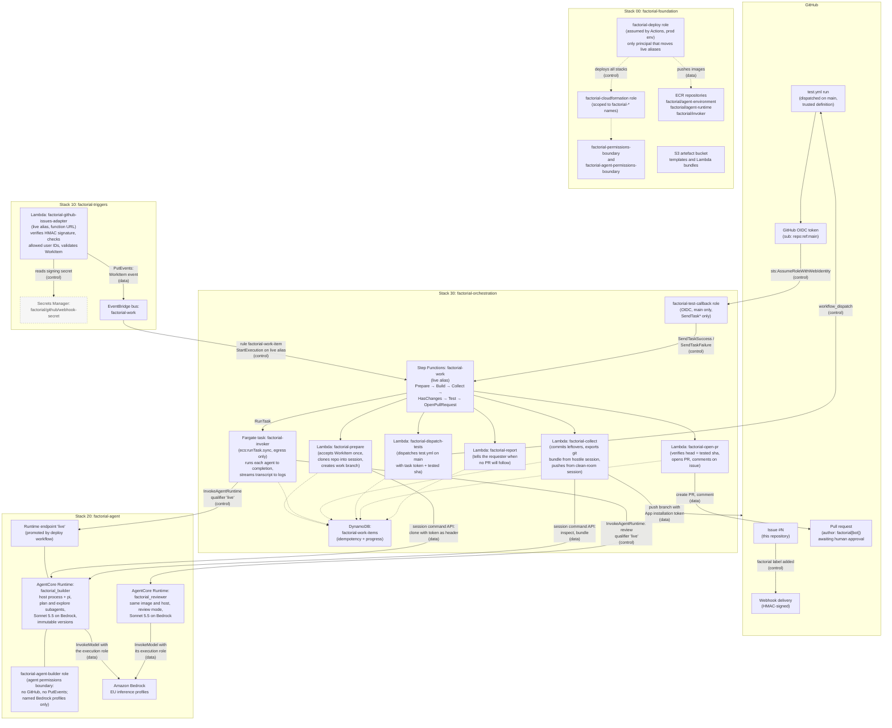

# System diagram

The current implementation (Stage 0): a labelled GitHub issue becomes a tested pull request with no human step in between. `CLAUDE.md` is the authoritative description; this diagram shows the same system visually. Human-provided inputs (the bootstrap, the GitHub App) are shown greyed with dotted borders; everything else is deployed by the deploy workflow from the templates in `templates/`.

The four CloudFormation stacks are shown as subgraphs: `factorial-foundation` (`00`), `factorial-triggers` (`10`), `factorial-agent` (`20`) and `factorial-orchestration` (`30`). Arrows labelled **control** carry a trigger or an invocation; arrows labelled **data** carry the work itself.

## The loop, step by step

1. **Trigger.** A human adds the `factorial` label to an issue. GitHub delivers a signed webhook to the adapter's function URL on its `live` alias.
2. **Adapt.** The adapter verifies the HMAC signature, checks that both the issue author and the labeller are trusted user IDs, builds one `WorkItem` (contract v1) and puts it on the `factorial-work` bus.
3. **Start.** The single bus rule matches `source: factorial.triggers` / `detail-type: WorkItem` and starts an execution of the `factorial-work` state machine on its `live` alias, passing the `WorkItem` as input.
4. **Prepare** (Lambda, deterministic). Accepts the `WorkItem` exactly once in the ledger (idempotency guard), mints a read-only installation token, clones the repository into a fresh builder session by the session command API (token sent as a header, never written into the session), creates the work branch and leaves `workitem.json` on disk.
5. **Build** (Fargate, `runTask.sync`). Step Functions runs the invoker task and waits. The invoker reads the `WorkItem` from the ledger, invokes the `factorial_builder` Runtime on the `live` endpoint in that session, and streams the transcript to CloudWatch Logs. Factorial's host process runs pi there, with every tool the model calls running as the unprivileged `agent` user. The builder first plans with its read-only plan subagent and writes `plan.json` and `plan.md`, which the host checks against the plan contract; the agent edits the code inside the sandbox, which holds no credentials beyond the execution role's model access.
6. **Collect** (Lambda, deterministic). Treats the session as hostile: validates and stores the builder's plan (no valid plan → **report** `invalid-plan`), commits anything uncommitted, exports the commits as a git bundle, and pushes the branch from a clean-room session with hooks disabled, using a fresh installation token.
7. **HasChanges** (Choice). No pushed commits → **report** (`no-changes`) and finish.
8. **Test** (Lambda + callback). Dispatches `test.yml` on the default branch with the task token and the tested commit sha. The checks job runs the untrusted commit with no credentials; the report job assumes `factorial-test-callback` through OIDC (main only) and sends task success or failure. Failure → **report** (`tests-failed`) and fail.
9. **OpenPullRequest** (Lambda). Confirms the branch head is still the tested commit, opens the PR attributed to `factorial[bot]`, and comments on the issue. A human reviews and approves.

## Versioning and promotion

Each part is independently versioned and referenced only through its `live` alias; templates create the aliases but never move them.

| Part | Versioned resource | `live` pointer |
|---|---|---|
| Agents | Runtime versions (builder, reviewer) | Endpoint named `live` |
| State machine | Step Functions versions | Alias named `live` |
| Adapters and Lambdas | Lambda versions | Alias named `live` |

The deploy workflow (GitHub Actions assuming `factorial-deploy`) is the only principal that promotes: it moves every runtime's `live` endpoint to the newest READY version as its final step, so the next `WorkItem` is handled by the newly deployed version. Lambda aliases and the state machine alias move during the deploy itself; separating all three promotions comes with the staging canary (a known Stage 0 gap).
