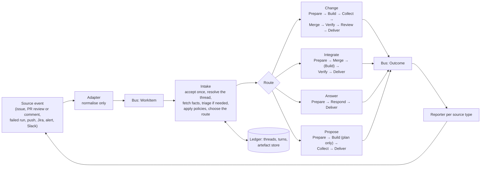

# Target state architecture

**Purpose.** This is the brief for re-implementing Factorial to its target state. It is written for the coding agent that will do that work and assumes no knowledge of the existing code. It states the shape to build, the rules that keep that shape, and the order to build it in. Decisions the target supersedes are left out on purpose.

`docs/architecture-principles.md` (the nine principles) and `docs/security.md` §1 and §2 (the threat model and its design rules) remain binding and are not repeated here. Where `docs/security.md` §3.5 or §6 describe verification as a dispatched workflow with a callback, this document is current. `docs/target-state-architecture.html` is the picture of the same design; open it in a browser.

The key words MUST, MUST NOT, SHOULD and MAY are used as in RFC 2119.

## 1. What Factorial is

A software factory: an agentic system that takes a request about a code repository and returns a pull request a human can approve. Its inputs are GitHub issues, events on its own pull requests, Jira tickets, production alerts and chat messages, with new kinds addable without changing the core. Its output is a pull request raised only once the change is implemented on a branch, has passed the checks the target repository declares, and has passed a smoke test in an ephemeral sandbox account. It builds and maintains itself through the same loop, and the end goal is maintaining other software, such as a runtime upgrade across many repositories.

Everything below follows from four facts about that job: the input is hostile, the model's output is a claim, the human is the gate, and the system must grow at its edges without changing its core.

## 2. Invariants

These hold from the first commit and are enforced by infrastructure, never by prompt.

1. **`live` aliases on every moving part.** Runtime endpoints, the state machine alias and Lambda aliases are all named `live`; every reference is by alias ARN; a version is immutable; in-flight executions finish on their version; promotion is the last step of a successful deploy and rollback is the same step in reverse.
2. **The `WorkItem` contract is the API.** One canonical shape in, changed only by a deliberate, human-approved decision through its documented process. Its counterpart, the `Outcome`, is the one shape out.
3. **Humans approve every pull request against Factorial's own code.** There is no privileged path for the system's changes to itself.
4. **Agents never deploy or promote Factorial.** Only the GitHub Actions deploy role may deploy a stack or move a `live` alias, enforced by two permissions boundaries that every role Factorial creates carries.
5. **Verification is Factorial's gate.** It runs in compute Factorial owns, from checks the target declares on its trusted branch, and nothing the agent can reach can forge its result. No untested or unfinished change becomes a pull request.

## 3. The shape

The vocabulary, used consistently in code, documents and prompts:

| Term | Meaning |
|---|---|
| **Source event** | Something that happened in an external system: a label added, a review submitted, a push, a Jira transition, an alarm, a chat message. |
| **Adapter** | A thin Lambda per source that verifies the event and turns it into exactly one `WorkItem`. It never interprets. |
| **`WorkItem`** | The canonical request: who asked for what, on which repository, and what it continues (`inReplyTo`). One repository per item. |
| **Turn** | One execution of the state machine for one `WorkItem`. |
| **Thread** | The ledger's record of one branch and everything said about it: its pull request, base, tested head, the turn in flight, counts. Every turn that runs stages belongs to a thread. |
| **Intake** | The first state. Deterministic work first, a model only when the facts cannot choose, policies after the model. |
| **Route** | Which stages a turn runs: `change`, `integrate`, `answer`, `propose`. A short fixed enum the orchestrator validates. A refusal is not a route. |
| **Stage** | One state in the fixed graph. Deterministic stages are code; agent stages run one role in one session. |
| **Role** | An agent definition fixed on an immutable Runtime version: builder, reviewer, triager, responder, verifier (no model). |
| **Session** | An isolated environment one stage runs in. Seeded by code, hostile once a model has run in it. |
| **Verifier** | One check the target declares, run by Factorial in a session it owns, reporting through one result contract. |
| **`Outcome`** | What the pipeline concluded about one turn: a result and pointers, never content. Emitted at every terminal state. |
| **Reporter** | A Lambda per source type that delivers an outcome where the turn came from. |
| **The record** | The artefact store (`<workItemId>/<attempt>/<stage>/`), the ledger (turns and threads) and the logs, joined by the work item id. |

## 4. Rules, by part

### 4.1 Adapters and the `WorkItem`

- An adapter MUST hold no credential beyond what verifies the event (a webhook secret, a signing secret) and MUST NOT read the ledger or call the source's API. It checks what the payload shows (signature, allowlisted requester, addressed to the bot) and emits facts: `source.type` says what happened, `source.id` and `source.url` point at it, `body` holds what was said, `requestedBy` who said it, `inReplyTo` what it continues. It MUST NOT choose a cause, guess a previous item or read state out of rendered text.
- Where a request has no repository of its own (a chat message, an alarm), the adapter takes it from a fixed syntax or from configuration, never from reading the request. If neither gives one, the adapter refuses in its acknowledgement.
- The schema is strict at the edge: an adapter rejects unknown fields. Downstream stages SHOULD tolerate unknown optional fields, so that an additive contract change needs no drain. `inReplyTo` kinds and `source.type` values are additive.
- One `WorkItem` is one repository, one branch, one pull request. Fan-out to many repositories happens before the stages run: in the adapter when the list is configuration, in Intake when it has to be worked out.
- `group` links the items one trigger produced; `parentId` links an item to the item that emitted it. Neither changes how an item is handled.

### 4.2 Intake, threads and routes

- Intake MUST run in this order: validate and accept the item exactly once; resolve the thread; fetch the facts the webhook did not carry, with a read-only repository-scoped token that never enters a session; choose the route; apply the thread policies; record; branch. The model, when it runs at all, sits between the facts and the policies.
- The facts decide the route whenever they can: a review requesting changes or a failed run is `change`; a push that leaves a pull request behind or conflicted is `integrate`; a derived item takes the route its parent chose. Only free text reaches the triager.
- A thread is keyed by the branch. For a new request Intake creates the thread with the branch Prepare will create, so every turn that runs stages has a thread before it starts. A request that fans out has no thread of its own; its derived items do.
- Admission is one conditional write on the thread: a turn claims `inFlight` only when it is empty or stale, and every terminal state releases it conditionally on holding it. The policies (eligibility of the pull request, one turn in flight, a cap on automatic reworks in a row, questions not counting against builds) live in one module and run after the model.
- A refusal is an outcome (`refused`, with a reason and, when a person asked, a reply), never a route. The route enum and the refusal reasons are separate types, so a triager can only ever pick a route.
- Intake records its decision and its reasons in `intake/intake.json`, validated against a schema under `contracts/`, and on the ledger row (`threadKey`, `route`, `priority`). A Choice state selects the path; any value outside the enum fails the execution, since it is a bug.

### 4.3 The triager

- A Runtime role with no tools and one turn. Its context is bounded and assembled by Intake: the request, who asked, the thread's previous turns and their outcomes, the registry of repositories Factorial may work on, and each target's triage hints from its `.factorial/`.
- It returns `triage.json`, validated against a schema: a verdict from the route enum, a priority from an enum with a reason, and one or more items, each a repository, a title and the request rewritten for it. Anything outside the schema is treated as an ask-back, never a build.
- It MUST NOT decide admission, `integrate`, the fan-out cap, whether a pull request opens, or anything about deployment.
- Several items become one derived `WorkItem` each on the bus, with `group` and `parentId`, deterministic ids so a retried Intake emits nothing twice; derived items are not triaged again. Above a cap, or when the request named no repository, the list is posted as a proposal and approval is the next turn.
- Priority is a decision on the turn, not a field on the `WorkItem`. It is recorded and shown; its first consumer is a concurrency gate that releases queued turns by priority then age under an account cap. Priority never pre-empts a running build, skips a policy or replaces human approval.

### 4.4 Stages and sessions

- The state machine is a fixed graph with agents inside states. The orchestrator decides what happens next; a model never does. Nothing inside a session is a control signal: completion is observed by infrastructure (a task run to completion, a task token completed by orchestrator code), never read from the model's output.
- Deterministic work (clone, seed, collect, merge, verify, push, open the pull request) is code. Agent work runs one role in one fresh session, seeded by code before any model runs, and hands the workspace to an unprivileged user before the model starts.
- A session is hostile from the first model token. Everything read out of it afterwards is one of a declared list of named files, each capped, redacted and validated, read as the unprivileged user. Nothing else leaves.
- Every agent has limits on turns, spend and time fixed on its version. A stage that stops early, however it stops, still has its committed and uncommitted work saved to the branch, and a turn that stopped early opens no pull request. A builder that runs out continues in a fresh session from the branch and its notes, up to a fixed number of rounds.
- Executions stay short. Nothing waits on a task token for a person: a reply, an approval or an answer is a new turn on the same thread.

### 4.5 Roles

- One manifest per role in one shared package: prompt, tools, subagents, hooks, limits, models by purpose, stage name and ledger statuses, the files the role is seeded with, and the files it may produce with a cap and a validator each. The host builds its options from it; the invoker takes stage and statuses from it; one generic Collect reads the declared outputs. No `role === '…'` conditional exists outside that package.
- The manifest is bundled into the host image, the invoker and the orchestrator, and only the host's copy is fixed on the Runtime version. The host alone uses prompt, tools, hooks, limits and models; everything else uses only stage, statuses, inputs and outputs. Nothing overrides a role at invoke time; the request carries only the prompt.
- One image for every role. One Runtime block per role in the template, with its own execution role and `live` endpoint, because IAM must stay explicit. Each role's execution role names exactly the inference profiles it may call, and the verifier's names none.
- Least privilege by role: the builder writes to its workspace and reaches the model; the reviewer and the responder are read-only; the triager has no tools; the verifier has no model and no access to any Factorial resource. The prompt explains the job; it is not a control.
- The plan stays inside the builder as a read-only subagent writing `plan.json` and `plan.md` to a contract. There is no separate planner role.

### 4.6 Seeds and providers

- One function assembles what a session starts with: files placed in the workspace, each capped, and sections of the first message. Prepare, ContinueBuild, PrepareReview and PrepareVerify call it with their list of providers.
- A provider is a function that owns one kind of context: the request, the thread's previous turns and their points, the stored plan, the previous round's notes, the diff, a verifier's failing log, the target's `.factorial/` instructions, and later a knowledge graph or a memory service. Adding a provider is a function and an entry in a list.
- Provider order is fixed, so numbering (rework points, questions) is stable across rounds and roles. Per-repository providers read from the target's base branch, never the branch under work. Everything from untrusted text is redacted and capped before it is written into a session, and no token is ever among it.

### 4.7 Collect and the clean room

- Collect inspects the hostile session as the unprivileged user, commits anything left uncommitted, stores the declared outputs, validates the ones that have a contract, and bundles the new commits. A build without a valid plan pushes nothing.
- The push happens from a pristine clean-room session that shares nothing with the agent's: no files, no git configuration, no hooks. Every commit is re-created under the App's bot identity, the push is always a fast-forward on the head the session started from, and only `factorial/*` branches are ever pushed to. No force push exists anywhere.
- Integration merges the base into the branch, never rebases, with no working tree and no hooks; a merge commit whose second parent is already on origin is the one merge the clean room allows. A base that moved during a build is merged before Verify on the Change route; a conflict is the one case where a builder runs on the Integrate route, seeded with the conflicted files and the base commits that touched them, and the review flags every conflicted file.

### 4.8 Verification

- Verify runs the ordered list in the target's `.factorial/verifiers.json`, read from the base branch, never from the branch under test. No file, or an invalid one, means no pull request.
- Each `command` verifier runs at the tested commit in a fresh session on the verifier Runtime. Orchestrator code clones with a short-lived read token that is used before any branch code runs and is not stored in the session, checks the head is the tested commit, hands the workspace over, and runs the declared command as the unprivileged user through the command API, waiting for it to finish. The command never runs in the orchestrator's or the invoker's own container, and the session's role can call no model and read no artefact, table or secret.
- The sandbox smoke test is the second verifier kind: orchestrator code deploys the tested commit to a leased ephemeral account and runs the declared check, with the lease, reset and guardrails held by orchestrator code, never by a session.
- Every verifier reports through one result contract at `verify/<name>/result.json` (name, kind, sha, outcome, exit code, duration, log pointer), with its logs beside it. Verifiers run in order on the same sha; a failing or timed-out required verifier ends the turn and later ones do not run.
- The pull request step MUST verify the branch head is the commit every required verifier passed. The target's own CI on the pull request is the independent second check, and a failure there is a new turn, not a verifier.

### 4.9 Review

- The reviewer runs in a fresh session at the tested commit with the plan, the builder's summary and the diff, treats everything it reads as untrusted, and writes `review.json` to a contract. It is advisory: the pull request opens with the review's verdict, scores and findings, or says the review did not complete.
- Sensitive-path rules come from the target's base branch (`.factorial/sensitive-paths.json`) plus built-in rules that hold for any repository; CollectReview adds a high-severity finding for every sensitive change whatever the reviewer wrote. Rename detection is off and diffs are forced to text, so a branch cannot hide what it changed.

### 4.10 Outcomes and reporters

- Every terminal state builds, validates, records and emits exactly one `Outcome` through one module: result, pointers (artefact prefix, pull request, branch, tested sha, saved work), the thread key, the route, the priority, and the `source` and `inReplyTo` of the turn. Pointers only, never content. It is recorded on the ledger and as `outcome/outcome.json` before it is put on the bus.
- A reporter per source type, selected by a rule on `source.type`, delivers it where the turn came from: opens or replies on the pull request thread, posts in the chat thread, updates the ticket. The state machine knows nothing about comments.
- Delivery never fails the turn. The outcome is recorded first; delivery is retried from the event, with a dead-letter queue and an alarm, and is idempotent per outcome. Only reporters mint delivery tokens; agent text they post is capped, redacted and cannot mention anyone.
- Opening the pull request itself is a repository operation behind the one GitHub module, not a reporter's job. Where a request came from and where the code lives are different dimensions.

### 4.11 The record

- Every stage writes under `<workItemId>/<attempt>/<stage>/` through one artefact module that redacts. Uploads are idempotent, the bucket is versioned, deletes are denied to every principal, and retention is a lifecycle rule.
- The store is write-only except for named keys the orchestrator reads back, each granted explicitly by key in the template and listed in the binding documentation. No agent role reaches the bucket.
- The ledger holds turns (status, route, priority, usage, pointers) and threads (branch, pull request, tested head, in flight, counts). It holds pointers and counts, never content.
- The work item id is the execution name, the session id, the ledger key, the artefact prefix and a field on every log line and state output; the thread key joins the turns on one branch. A document in the repository says how to reach every record of a run from that id, and every change that adds a record updates it.

### 4.12 Versioning and deployment

- Everything is CloudFormation, deployed by GitHub Actions over OIDC bound to `main` and a protected environment, except the foundation stack (boundaries, roles, buckets, registry), which a human deploys once. No access keys exist.
- A deploy builds and publishes every version, runs a canary work item against a trivial target, and only then moves every `live` alias. In-flight executions finish on their version. A deploy skips when only non-functional paths changed, and one script is the single list of those paths.
- A contract change ships alone, labelled, and either tolerates unknown fields downstream or waits for in-flight executions to drain before promotion.
- The agent image is one `linux/arm64` image holding no credentials, tagged by a hash of its inputs and rebuilt only when that changes.

### 4.13 Targets

- Nothing in the code, prompts or image assumes the target is Factorial. Per-repository settings live in the target's `.factorial/` and are read from its base branch: verifiers, sensitive paths, pull request body facts, instructions, triage hints. Factorial keeps its own there like any other target.
- A second, trivial target repository exists from day one and is what the canary runs against, so target-agnosticism is exercised on every deploy rather than asserted.
- The toolchain in the image is a decision per target language; the first version supports one and says so.

### 4.14 Conventions

- TypeScript for everything Factorial owns, including the agent host; CloudFormation YAML with the `.yml` extension, numbered templates, the Serverless transform with `AutoPublishAlias: live`; every Lambda dependency bundled, the AWS SDK included.
- Every role is named `factorial-*` and carries a boundary: agent roles `factorial-agent-*` with the agent boundary, all others with the runtime boundary; AgentCore resources `factorial_*`, everything else `factorial-*`. The CloudFormation execution role is scoped to those names.
- Serverless first; Fargate where a container is unavoidable; never EC2. One region.
- Workflows: every remote action pinned to a commit SHA, no Actions cache, every job that assumes the deploy role declares the environment and the full trust gate, and a script enforces those rules in CI.
- Layout: `contracts/` (JSON Schema), `packages/` (TypeScript workspaces), `templates/`, `scripts/`, `.github/workflows/`, `.factorial/`, `docs/`. UK English throughout.

## 5. What an extension costs

If adding something costs more than this table says, the boundary is in the wrong place and the design, not the extension, is what to fix.

| To add | Write | Touch nothing in |
|---|---|---|
| A trigger source | An adapter Lambda and a reporter Lambda, each with a rule; a `source.type` value; an `inReplyTo` kind if replies continue a thread | Intake, the routes, the stages, the contracts' shapes |
| A kind of context | One provider function and a list entry | The stages, the roles |
| A check | One entry in the target's `verifiers.json`; a verifier kind if it is a new way of running one | The state machine (a kind is a Choice branch), the pull request step |
| A role | A manifest, a prompt, a template block, the states that use it | The host, the invoker, Collect |
| A route | Its states, a prompt section, a reporter case, a value in the enum | Intake's policies, the contracts |
| A target repository | The App installation and a `.factorial/` folder on its base branch | Any code, template or secret |

## 6. Build order

Each step is the smallest version that closes its loop, is deployed through the pipeline, and leaves the documentation describing what exists. Nothing is built ahead of the step that needs it, except what section 2 fixes from day one.

1. **Foundation**: boundaries, the name-scoped CloudFormation role, OIDC deploy role, buckets, registry, the GitHub App and the rulesets. Human-deployed once.
2. **Contracts**: `WorkItem`, `Outcome`, `intake`, `plan`, `review`, `verifiers`, `triage`, `questions`, each with a validator and examples. The shapes are cheap to write first and expensive to retrofit.
3. **Bus, issue adapter, ledger with threads, artefact store, Intake** with the `change` route only and fact-based routing. The first turn ends at `intake.json`.
4. **The Change route with the builder**: Prepare, Build, Collect and the clean-room push; role manifests and seed providers from the start, since the first role written is the one that gets copied.
5. **Verify** with the `command` kind and the verifier Runtime; `.factorial/verifiers.json` for Factorial and for the trivial second target; the pull request step with the head check. The loop now closes: an issue becomes a verified pull request.
6. **Outcomes and the GitHub reporter**, so the state machine stops knowing about comments before a second source arrives.
7. **Review**, advisory, with the sensitive-path rules.
8. **The canary** against the second target, promotion as the last deploy step.
9. **Pull request events as turns**: review, inline comment, conversation comment, failed run, with threads carrying the admission policies.
10. **The sandbox verifier** and the account pool.
11. **The triager and the responder**, the `answer` route; then `propose`, Clarify, `integrate` and the push adapter.
12. **Further sources** (chat, Jira, alerts), each an adapter and a reporter; the concurrency gate when priority has something to schedule.

From step 4 onwards, Factorial's own work items are the way most steps are built.

## 7. Decisions left open

These are not settled by the design. Decide each once, record the decision beside this document, and do not let an implementation settle it by accident.

- **Session compute.** The design assumes an AgentCore Runtime per role with a session command API, invoked through a Fargate task that runs to completion. The alternative is the Agent SDK directly in a Fargate task with the seed and collect phases as root-run scripts around an unprivileged model phase. The Runtime buys managed isolation and versioned endpoints at the cost of the extra invoker layer. Decide on evidence from the first builder, with isolation and the alias principle as the criteria.
- **Tolerant downstream validation.** Section 4.1 says SHOULD. Make it MUST, or keep drains, before the second contract change.
- **Cross-source notification.** Whether a thread's opener (a chat thread, a ticket) is told about turns that came from GitHub, such as a review or a merge. The thread records its opening source, so the reporter can; the design does not say it should.
- **Fan-out cap and confirmation.** The number of derived items above which Intake posts a proposal instead of running, and whether a human can raise it per target.
- **Toolchains.** One image per target language, or one image with several. Needed at the first non-Node target.

## 8. Where this came from

The design behind this document is `docs/design-extension-points.md` (threads, routes, outcomes, manifests, seeds, verifiers) and its issues #163 to #169, with #161 (triage and the responder), #155 (integration), #15 (progress and the reporter seam), #13 (the canary), #50 and #51 (the sandbox smoke test) and #91 (target-agnosticism) reshaped onto them. The current implementation and its history are in `docs/current-stage.md`; they are not an input to a rebuild.
